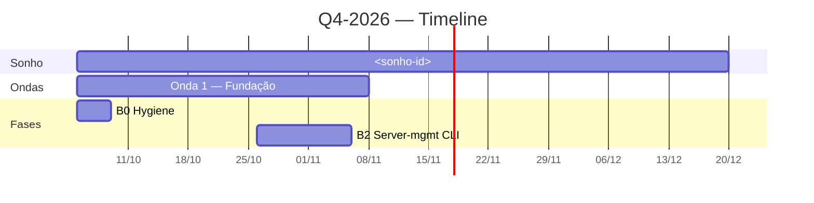

# SPEC-04 — O Artefato: a timeline que você abre

**Date:** 2026-10-30 · **Status:** proposed · **Depends on:** 01, 02, 03 · **Blocks:** 05

## Goal
Um comando produz `timeline.md` (Mermaid, abre no Obsidian/GitHub) e `timeline.html` (abre no navegador) juntando **plano do vault + execução da fila + gasto do fin_ops**.

## Por que agora
O renderer já existe e funciona: `src/mesh/gantt_engine.py` (356) + `gantt_renderers.py` (201, `render_ascii` e `render_html` com CSS embutido e classes `gantt-planned/-progress/-done/-overdue`) + `src/mesh/cli/td_gantt.py` (253), mais `td optimize` (topológico). Tem até `test_gantt_optimizer.py` (423 LOC).

**O que falta é a entrada.** Hoje `td gantt` lê só o store do taskdog. E as duas interfaces instaladas nunca foram ligadas: `grep fin_ops life/` → 2 arquivos, ambos prosa. Zero código. **Esta spec é a integração horizontal que nunca existiu.**

## Anti-padrão que este spec evita
Um artefato que só o sistema sabe ler não é um artefato — é mais uma tela. O output tem que abrir em **duas ferramentas que você já usa** (Obsidian, navegador) sem instalar nada.

## Decisões
- **D1** — Três fontes, três responsabilidades: **plano** = markdown do vault (canônico); **execução** = `td gantt --mode=json` (não reimplementar a leitura da fila); **custo** = `fin_ops report --period month --json`.
- **D2** — Sem LLM, sem grafo, sem MCP. O skill é **consumidor**: lê e escreve arquivos.
- **D3** — Output append-only: `timeline-YYYY-MM-DD.md` e `timeline-YYYY-MM-DD.html`. O anterior fica como histórico.
- **D4** — Só `status == "propagated" | "approved"` da fila entra no Gantt. `pending`/`clarify` vão para "Aguardando validação" — **a fila não é o plano**.
- **D5** — Custo é **anotação**, nunca barra. Gasto não é duração.
- **D6** — Fases vêm do quadro de fases do plano trimestral (colunas `Início`/`Fim`); ondas vêm da janela `Suggested window: A → B`. **Barra sem data usa o fim do trimestre e é marcada `sem data` na legenda.**
- **D7** — Lacuna é informação. Se `00-sonho/` estiver vazio ou uma onda sem janela, a timeline **mostra a lacuna**; o skill não edita o vault para "aclimatar".

## Files
- **Create:** `src/mesh/vault_gantt.py` (~200 LOC) — markdown do vault → `GanttPlan`
- **Modify:** `src/mesh/cli/td_gantt.py` — flag `--from-vault` (~40 LOC)
  > **Verificado (2026-10-30):** `render_ascii` está em `src/mesh/gantt_renderers.py:57` e `render_html` em `:162` — os dois renderizadores existem e aceitam `GanttPlan`. **Não existe** nenhuma flag `--from-vault` nem símbolo `from_vault` no código: a lacuna é exatamente a **entrada**, não o render. Por isso o Task 4.2 tem ~40 LOC — reaproveita `GanttEngine` + `GanttConfig` + os dois renderizadores. **Não** duplique a lógica de render.
- **Create:** `life/.claude/skills/ikigai-timeline/SKILL.md` (~90 LOC)
- **Create:** `src/ikigai/tests/test_vault_gantt.py` (~120 LOC)

## Interfaces
- **Consumes:** `src.contracts.vault_paths` (SPEC-01), `GanttEngine`/`GanttConfig`/`GanttPlan`, `src.mesh.gantt_renderers.render_html`, `TaskdogAdapter.list_all()`, `fin_ops report --json`
- **Produces:** `<quarter>/01-plano-trimestral/timeline-YYYY-MM-DD.{md,html}`

## Contrato
```bash
python -m src.mesh.taskdog_cli gantt --from-vault --mode=html \
  --out "vault/ikigai/closing-2026/02-q4-2026/01-plano-trimestral/timeline-2026-10-30.html"
```

`timeline.md`:


## Steps

### Task 4.1 — `src/mesh/vault_gantt.py`
- [ ] `parse_phases(plan_md) -> list[Phase]`: ler a tabela de fases (colunas `Fase | Phase name | Weeks | Sprint | Início | Fim`).
- [ ] `parse_waves(onda_md) -> list[Wave]`: ler `Suggested window: A → B`.
- [ ] `parse_tasks(queue_json, taskdog_json) -> list[Task]`: unir por `ueid`; `propagated|approved` entram como task; `pending` viram `waiting`.
- [ ] `parse_spend(fin_ops_json) -> dict`: total + capex/opex do período.
- [ ] `build_plan(...) -> GanttPlan`: fases → barras `planned`; tasks → barras com status real.
- **Verify:** `pytest src/ikigai/tests/test_vault_gantt.py -v` → PASS; e o teste **falha** se o parser aceitar uma data inventada.

### Task 4.2 — `--from-vault` no `td_gantt.py`
- [ ] Nova flag; quando presente, a fonte é o vault em vez do store.
- [ ] Reusar `GanttEngine` + `GanttConfig`; **não** duplicar a lógica de render.
- **Verify:** `python -m src.mesh.taskdog_cli gantt --from-vault --mode=ascii` → tabela ASCII com as fases do Q4.

### Task 4.3 — skill `ikigai-timeline`
- [ ] `life/.claude/skills/ikigai-timeline/SKILL.md`: fontes, procedimento em 7 passos, invariantes, formato de saída para o usuário. **Sem LLM, sem grafo, sem MCP.**
- [ ] A skill **lê** o plano, **chama** o CLI, **escreve** os 2 arquivos e **imprime** o resumo.
- **Verify:** `grep -rn "langgraph\|mcp_bridge" .claude/skills/ikigai-timeline/` → 0 hits

### Task 4.4 — teste end-to-end
- [ ] Com fixture (1 sonho, 1 plano com 2 fases, 1 onda, 1 nota diária, 2 eventos de fila) → `build_plan` devém `GanttPlan` com 1 sonho + 1 onda + 2 fases + 1 task waiting.
- [ ] Teste que `render_html` contém `gantt-planned` e `gantt-done`.
- **Verify:** `pytest src/ikigai/tests/test_vault_gantt.py -v` → PASS

### Task 4.5 — rodar de verdade
- [ ] `python -m src.mesh.taskdog_cli gantt --from-vault --mode=html --out .../timeline-<hoje>.html`
- [ ] Abrir o `.md` no Obsidian e o `.html` no navegador.
- **Verify:** os dois abrem e mostram fases + ondas + tasks + custo.

## Done criteria — observável por uma pessoa
| Quando | Alguém pode… |
|---|---|
| 4.5 verde | Abrir `timeline.md` no Obsidian e ver as fases do Q4, a janela da onda, as tasks que existem, as que aguardam validação e o gasto do período. |
| 4.3 verde | O skill roda **sem LLM**: `python -m src.mesh.taskdog_cli gantt --from-vault` é o único comando. |
| 4.4 verde | Um teste garante que a timeline **não inventa data**: barra sem data → fim do trimestre + `sem data`. |

## Fora de escopo
Editar o vault para aclimatar a timeline (D7) · `update`/`done` no mesh · gradiente de custo no eixo temporal · interativo no navegador.

## Self-review
D1–D7 nos Tasks 4.1–4.5; cada Task tem verificação. **Depende de 01** (paths), **02** (notas reais) e **03** (tasks reais). **Sem os três, a timeline sai vazia** — e isso é o sinal de que a cadeia ainda não fecha.

*Spec 04 proposed 2026-10-30.*
