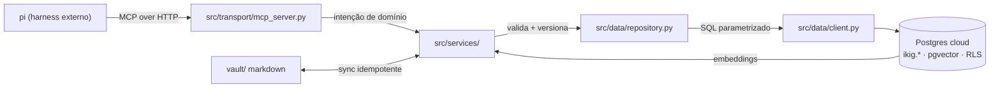
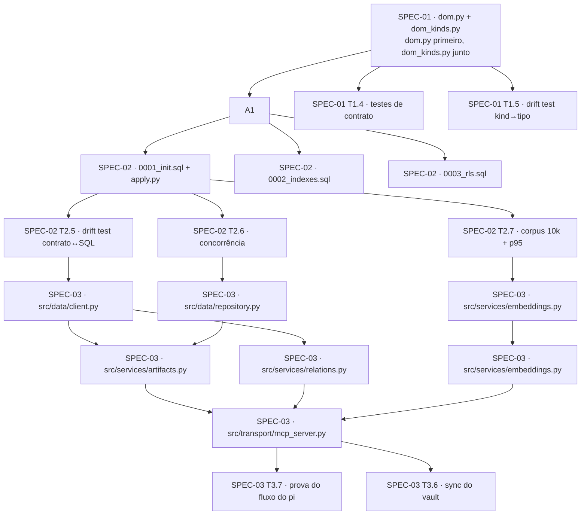

# TECH.md — Camada de dados (DOM + store cloud + services/MCP)

**Feature id:** `data-layer`
**Data:** 2026-11-01
**Status:** proposed — aguardando ratificação de R1 (fornecedor) e aprovação do owner
**Decisão que ancora:** [`ADR-037`](../../code-docs/adr/ADR-037-data-layer-canonical-turn.md)
**Série de specs (comportamento):** [`2026-11-01-00-data-layer-series.md`](../../docs/superpowers/specs/2026-11-01-00-data-layer-series.md) · [01 DOM](../../docs/superpowers/specs/2026-11-01-01-unified-dom.md) · [02 Store](../../docs/superpowers/specs/2026-11-01-02-cloud-store.md) · [03 Service+Transporte](../../docs/superpowers/specs/2026-11-01-03-service-transport-pi.md)

> Este documento **não re-descreve** o schema nem o SQL — as specs 01/02/03 já
> descrevem e verificam. Aqui está o **plano de implementação**: o que muda,
> quem possui o quê, como se prova, e como se paraleliza.
> Todo comportamento observável é referenciado pela spec que o define.

---

## 1. Context

### O que será construído

Três camadas novas, em ordem estrita: **DOM** (contrato), **store** (Postgres
serverless), **services + transporte MCP**. O harness **pi** — que já existe no
repo — passa a ler e escrever por essa camada, sem que a repo construa
agent framework algum.

### Como o sistema funciona hoje na área tocada

| Fato hoje | Referência |
|---|---|
| O contrato canônico é Pydantic v2 estrito: `frozen=True`, `extra="forbid"`, sem lógica de negócio | [`src/contracts/__init__.py:1-21`](https://github.com/matheusmendes720/ikigai/blob/ac71dbf7/src/contracts/__init__.py#L1-L21) |
| O identificador universal é `class UEID(str)` com schema Pydantic custom, sobre um regex **de fonte única** | [`src/contracts/common.py:40-48`](https://github.com/matheusmendes720/ikigai/blob/ac71dbf7/src/contracts/common.py#L40-L48) · [`src/contracts/common.py:60-152`](https://github.com/matheusmendes720/ikigai/blob/ac71dbf7/src/contracts/common.py#L60-L152) |
| `sys_ikigai` **importa** o regex canônico (ADR-033) — mas expõe uma **segunda identidade de tipo** (`Annotated[str, StringConstraints]`) | [`sys_ikigai/entities/ueid.py:21-33`](https://github.com/matheusmendes720/ikigai/blob/ac71dbf7/sys_ikigai/entities/ueid.py#L21-L33) |
| O padrão de contrato estrito, campo a campo, já existe | [`src/contracts/task.py:27-60`](https://github.com/matheusmendes720/ikigai/blob/ac71dbf7/src/contracts/task.py#L27-L60) |
| **O grafo já existe dentro do contrato** — `Task.depends_on: list[UEID]` | [`src/contracts/task.py:56-57`](https://github.com/matheusmendes720/ikigai/blob/ac71dbf7/src/contracts/task.py#L56-L57) |
| `src/contracts/` re-exporta tudo em `__init__.py`, **exceto** o que criaria import circular (o `TaskChange` fica acessível só por dotted-prefix) | [`src/contracts/__init__.py:100-103`](https://github.com/matheusmendes720/ikigai/blob/ac71dbf7/src/contracts/__init__.py#L100-L103) |
| O drift net é um detector que **faz parse do código-fonte** com `ast` e resolve a raiz do repo subindo os `parents` | [`src/ikigai/tests/test_drift_extended_invariants.py:35-53`](https://github.com/matheusmendes720/ikigai/blob/ac71dbf7/src/ikigai/tests/test_drift_extended_invariants.py#L35-L53) |
| O CI roda 5 pacotes num matrix `include`; pacotes flat-layout sem `pyproject.toml` entram como `ruff-only` com `ruff_target: .`, e seus testes são exercitados **transitivamente** por um pacote que os importa | [`.github/workflows/ci.yml:66-120`](https://github.com/matheusmendes720/ikigai/blob/ac71dbf7/.github/workflows/ci.yml#L66-L120) |
| A superfície MCP atual é um **bridge de 22 tools das quais 9 apontam para tools inexistentes** | [`src/ikigai/src/agents/v2/mcp_bridge.py:88-130`](https://github.com/matheusmendes720/ikigai/blob/ac71dbf7/src/ikigai/src/agents/v2/mcp_bridge.py#L88-L130) |

### A premissa que muda o desenho

Hoje o `metadata` dinâmico do daily **se perde no JSON** porque `asdict` só
serializa campos declarados ([`src/ikigai/src/agents/v2/skills/ikigai_daily.py:97`](https://github.com/matheusmendes720/ikigai/blob/ac71dbf7/src/ikigai/src/agents/v2/skills/ikigai_daily.py#L97)).
O DOM resolve isso **no contrato**, não no consumidor: `metadata` deixa de ser
atributo dinâmico e vira campo tipado (SPEC-01 §D1).

---

## 2. Proposed changes

### 2.1 Mapa de módulos

```
src/contracts/           (pacote EXISTENTE — canonical contracts layer)
  dom.py                 NOVO  ~320 LOC  ArtifactKind, Artifact, Relation, WriteRequest, SearchQuery
  dom_kinds.py           NOVO  ~260 LOC  um tipo derivado por kind + ArtifactRevision
  store.py               NOVO  ~150 LOC  PROVIDER, EMBEDDING_DIM, KIND_TABLES, SCHEMA_VERSION
  migrations/            NOVO           0001_init.sql · 0002_indexes.sql · 0003_rls.sql · apply.py

src/data/                NOVO  (flat, sem pyproject — igual src/mesh)
  client.py              ~180 LOC  pool, retry, transação, healthcheck
  repository.py          ~260 LOC  persistência pura (upsert/search/relations/revisions)

src/services/            NOVO  (flat)
  artifacts.py           ~200 LOC  unico writer de artefato; validacao + versionamento
  relations.py           ~140 LOC  navegação do grafo (visited set, sem ciclos)
  embeddings.py          ~110 LOC  vetorização + cache por hash do texto
  sync.py                ~220 LOC  ingestion vault markdown → store, idempotente

src/transport/           NOVO  (flat)
  mcp_server.py          ~160 LOC  fastmcp + 6 tools por intenção de domínio
```

**Import dentro de `src/contracts/` é relativo** (`from .common import UEID`),
como em [`src/contracts/task.py:20`](https://github.com/matheusmendes720/ikigai/blob/ac71dbf7/src/contracts/task.py#L20).
**Dotted-prefix é para crossing de pacote** (`from src.contracts.common import ...`),
como em [`sys_ikigai/entities/ueid.py:25`](https://github.com/matheusmendes720/ikigai/blob/ac71dbf7/sys_ikigai/entities/ueid.py#L25).
O DOM usa **a classe** `UEID` de `src/contracts/common.py` — uma identidade só
(ADR-033 Alt E permanece deferido; o DOM não o reabre).

### 2.2 Fronteiras de ownership

| Store / artefato | Writer único | Leitores |
|---|---|---|
| `vault/` markdown | `vault_write` (ADR-012, **inalterado**) | todos, só leitura |
| `ikig.*` no Postgres | **`src/services/`** — nada mais escreve | `src/services/`, `src/transport/` |
| `src/contracts/` | só o contrato; **sem I/O** | todo o repo |
| `src/mesh/` | **não toca** no DOM | — |

Nenhum cliente fala com o banco. Nenhuma tool MCP fala SQL. (ADR-037 §6 R2/R3.)

### 2.3 Fluxo de dados



O caminho de leitura de dado estruturado **não passa pelo markdown**. O
markdown continua sendo o store de prosa e é ingerido no store; o store vence
em campo estruturado (ADR-037 D4).

### 2.4 Types introduzidos

Todos em `src/contracts/dom.py` + `dom_kinds.py`, Pydantic v2 estrito:

| Tipo | Papel |
|---|---|
| `ArtifactKind` | enum de 10 kinds (`sonho`, `plano`, `onda`, `fase`, `revisao`, `nota`, `kpi`, `desc`, `okr`, `tarefa`) |
| `Artifact` | espinha: `uid`, `kind`, `title`, `body`, `body_hash`, `parent_uid`, `quarter`, `status`, `revision`, timestamps, `deleted_at` |
| `KPIArtifact`, `OKRArtifact`, `DecisionArtifact`, … | um derivado por kind, com `Literal[ArtifactKind.X]` como discriminador |
| `RelationType`, `Relation` | arestas tipadas do grafo |
| `WriteRequest` | `artifact` + `expected_revision` + `idempotency_key` + `client_id` |
| `SearchQuery`, `SearchResult` | busca por índice estruturado, cursor-based |
| `ArtifactRevision` | histórico append-only (uid, revision, snapshot, author, client_id) |
| `WriteOutcome` | `created` / `updated` / `conflict` / `unchanged` |

`make_uid(kind, slug, uuid_short, content_hash_short) -> UEID` monta o formato
**4-part** (ADR-014) e **valida** pelo construtor `UEID` — nunca concatena
cego. `KIND_NAMESPACE` é exportado: é o contrato que o cliente usa para
converter "um KPI do vault" em UID.

### 2.5 Tradeoffs (onde havia mais de um caminho razoável)

| Decisão | Alternativa | Escolha e por quê |
|---|---|---|
| **Onde a validação do payload acontece** | (a) no contrato Pydantic · (b) na service layer | **As duas, em camadas diferentes**: o Pydantic valida *forma* (`extra="forbid"`, tipos, enums) na borda; a service valida *regra* (o `expected_revision` bate, o pai existe, o kind tem extensão). Uma só camada deixaria ou a API ou o store sem validação. |
| **Onde o 409 é traduzido** | (a) repository levanta `ConflictError` → (b) service traduz para o tipo de erro do MCP | **(b)** — a service é a fronteira de domínio; o repository só reporta "0 linhas afetadas". O transporte mapeia erro de domínio → erro MCP tipado. |
| **`src/data/` novo vs. reuso de `src/mesh/`** | (a) novo pacote `src/data/` · (b) estender `src/mesh/` | **(a)** — `src/mesh/` é o data mesh de *tasks entre forks* (create-only, v1.2+ para update). O store do vault é outra coisa: versionado, multi-kind, com RLS. Misturar os dois reconstruiria o fork que o ADR-037 quer matar. `src/mesh/` continua consumindo `src/contracts/`. |
| **Onde mora o sync do vault** | (a) `src/services/sync.py` · (b) um daemon separado | **(a)**, com invocação por cron ou pelo `life` CLI. Um daemon é o modo de falha que o Vanilla Pivot §1 diagnosticou (6 daemons, 823 logs, "No change recommended" ×5). Sync é **uma função invocável**, não um processo. |
| **Embeddings: coluna ou tabela** | (a) coluna `vector` em `artifacts` · (b) tabela separada | **(a)** — uma transação, um backup, um RLS. Tabela separada reintroduz o "Chroma separado" (SPEC-02 §Anti-padrão). |
| **`client_id` no payload ou no token** | (a) cliente manda · (b) service injeta | **(b)** — cliente escollendo o próprio `client_id` é um furo de RLS. O campo existe no contrato (para auditoria), mas quem o preenche é a service, a partir do token. |

### 2.6 CI — o que precisa entrar no matrix

Três pacotes novos (`src/data/`, `src/services/`, `src/transport/`) são
**flat-layout, sem `pyproject.toml`** — o mesmo caso de `src/mesh/`. Pelo padrão
já documentado no matrix ([`ci.yml:89-115`](https://github.com/matheusmendes720/ikigai/blob/ac71dbf7/.github/workflows/ci.yml#L89-L115)),
eles entram como `manager: ruff-only`, `ruff_target: .`.

Os **testes** dos pacotes novos são exercitados **transitivamente** pelo
entry `interfaces-cli` — que já importa `src.mesh` + `src.contracts` e passa a
importar `src.services` + `src.transport`. Alternativa: um entry `src-data`
dedicado. **Recomendação:** adicionar o entry dedicado (`src-data`,
`ruff-only`) porque os testes do store precisam de **Postgres real** — o
`interfaces-cli` não pode depender de um serviço externo no CI.

> **Decisão pendente:** Postgres no CI (Supabase local / `pgvector` em serviço
> Docker / testcontainers). Sem isso, os testes de store rodam **só em local** e
> a Task 2.5 (drift test contrato ↔ SQL) vira a única verificação em CI — o que
> é mais fraco do que a spec pede. **Levantar antes da Task 2.2.**

---

## 3. Testing and validation

Cada invariante numerada da série mapeia para um teste concreto. O teste novo
precisa **morrer quando a implementação é revertida** (mutation check) — a
regra que o Vanilla Pivot §"3 regras que importam" fixou e que o loop
`converge` nunca chegou a aplicar.

| Origem | Invariante | Verificação | Tipo |
|---|---|---|---|
| SPEC-01 T1.4 | `extra="forbid"` + `frozen` em todo modelo do DOM | `test_extra_fields_rejected`, `test_frozen` | unit |
| SPEC-01 T1.4 | o DOM usa a **classe** `UEID`, não o `Annotated` | `test_uid_is_the_contract_class` — inspeciona `model_fields["uid"].annotation` | unit |
| SPEC-01 T1.3 | o namespace existe para todo kind e o UID gerado é aceito pelo construtor | `test_every_kind_has_a_namespace`, `test_make_uid_roundtrip` | unit |
| SPEC-01 **T1.5** | **nenhum kind existe sem tipo derivado, namespace e spec** | drift test que enumera `ArtifactKind` e falha se um kind novo não tiver tipo | **drift** |
| SPEC-02 T2.2 | migration é idempotente | aplicar duas vezes → **no-op** (checksum), não re-aplica | integração |
| SPEC-02 **T2.5** | **o SQL não diverge do contrato** | `test_uid_check_matches_contract_pattern` (a regex do `check` vem de `_UEID_PATTERN`, não copiada) · `test_every_kind_has_a_column_check` · `test_extension_tables_cover_typed_kinds` | **drift** |
| SPEC-02 T2.4 | RLS isola clientes | com `client_id=A`, `select` de `B` → **0 linhas**; com RLS off → linhas | integração |
| SPEC-02 **T2.6** | **conflito explícito, nunca last-write-wins** | 2 escritas concorrentes, mesmo `expected_revision` → **1× 409, 0 sobrescrita**. O teste morre se o `upsert` virar `on conflict do update` | integração |
| SPEC-02 T2.7 | busca por índice estruturado é rápida | corpus de 10k; `p95` < 50ms estruturada, < 150ms semântica | benchmark |
| SPEC-02 T2.7 | o planner usa índice | `explain analyze` → **Index Scan**, não Seq Scan | integração |
| SPEC-03 T3.2 | idempotência | 2 chamadas com a mesma `idempotency_key` → **1 escrita** | integração |
| SPEC-03 **T3.3** | **conflito é `CONFLICT`, não sobrescrita** | `upsert_artifact` com `expected_revision` velho → `WriteOutcome.outcome == "conflict"` | unit+integração |
| SPEC-03 T3.4 | navegação do grafo não entra em ciclo | `A → B → C → A` termina; embedir o mesmo texto 2× → **1 chamada** ao modelo | unit |
| SPEC-03 **T3.5** | **a superfície MCP não expõe SQL** | grep por `select `/`insert ` no `mcp_server.py` → **0 hits**; as 6 tools respondem com JSON | estático+integração |
| SPEC-03 T3.6 | o sync é idempotente | rodar 2× → **mesmo count** no store; a nota de 2026-10-30 aparece com `kind='nota'` | integração |
| SPEC-03 **T3.7** | **o pi lê e escreve pelo store no fluxo normal** | `test_pi_flow.py`: pedido ao pi → `search` devolve do store; `upsert` → `artifact_revisions` com o `client_id` do pi. **O teste consulta o store de verdade** — se o MCP não estiver carregado, ele morre | **e2e** |
| ADR-037 §8 | **a métrica de 14 dias** | nota escrita sem editar arquivo à mão, de cliente não-desktop (≥5) · **0 lost update** com 2 clientes · `p95` < 100ms | manual, 14 dias |

### Passos manuais (não automatizáveis)

1. **R1 — ratificar o fornecedor.** Criar o projeto Postgres, habilitar
   `pgvector` + `pg_trgm`, confirmar que o segredo vive **fora** do repo.
2. **SPEC-03 T3.7 — o fluxo do pi.** Abrir o pi, pedir "liste os KPIs do
   Q4-2026" em linguagem natural, e **conferir no store** — não no terminal.
3. **A métrica de 14 dias.** Rodar o sistema de verdade e medir as três
   métricas. Sem isso, a virada não foi verificada.

---

## 4. Parallelization

### O grafo de dependências

O gargalo real é o **contrato**: `src/contracts/dom.py` é pré-requisito de
tudo, e o store é pré-requisito do transporte. Mas **dentro** de cada fase há
frentes independentes reais.



### Os agentes propostos

| Agente | Escopo | Modo | Worktree / branch | Fronteira de arquivos |
|---|---|---|---|---|
| `dom-contract` | SPEC-01 T1.1–T1.4 | local | `life/.claude/worktrees/dom-contract` · branch `feat/data-dom` | **dono** de `src/contracts/dom.py` + `dom_kinds.py` + `src/ikigai/tests/contracts/` |
| `migrations` | SPEC-02 T2.2–T2.3 | local | `life/.claude/worktrees/migrations` · branch `feat/data-store-schema` | **dono** de `src/contracts/migrations/` + `src/contracts/store.py` |
| `store-drift` | SPEC-02 T2.5 | local | dentro do worktree de `migrations` | dono de `src/ikigai/tests/store/` |
| `data-client` | SPEC-03 T3.1–T3.2 | local | `life/.claude/worktrees/data-client` · branch `feat/data-client` | dono de `src/data/` |
| `services` | SPEC-03 T3.3–T3.4 | local | `life/.claude/worktrees/services` · branch `feat/data-services` | dono de `src/services/` (menos `sync.py`) |
| `transport-pi` | SPEC-03 T3.5–T3.7 | local | `life/.claude/worktrees/transport` · branch `feat/data-transport` | dono de `src/transport/` + `src/services/sync.py` |

**Coordenação:** o contrato é o **merge point** — `dom-contract` e
`migrations` fazem merge em `feat/data-layer` **antes** de `data-client` e
`services` começarem (eles importam `src.contracts.dom`). Nenhum agente
escreve em arquivo de outro: as fronteiras acima são disjuntas por
construção, e o único compartilhado é `src/contracts/`, que é mergeado
primeiro.

**Validação por dono:** cada agente roda o gate do seu pacote
(`ruff check` + `ruff format --check` no seu diretório) **e** o pytest do
seu próprio diretório de teste. A validação cruzada (o drift test que
atravessa contrato ↔ SQL) fica com o dono do store, que roda contra o
contrato já mergeado.

**Um PR por agente** ou **um PR combinado**? **Combinado**, em 3 PRs por fase
(fase 1 · fase 2 · fase 3) — porque as fases têm contratos de API entre si e
revisar 6 PRs intercalados não agrega. Dentro de cada PR, os commits são
separados por agente.

### Por que `data-client` e `services` **não** rodam em paralelo

O `repository.py` precisa do schema aplicado (a migration 0001 tem que estar
rodada), e o `artifacts.py` precisa do `repository.py`. A dependência é de
*estado do banco*, não só de código — dois agentes subindo contra o mesmo
store remoto colidiriam na aplicação da migration. **Sequencial dentro da
fase 3**, e o `embeddings.py` é a exceção: ele não toca o schema de escrita e
pode rodar em paralelo com `client.py`/`repository.py`.

### Quando a paralelização **não** ajuda

- **A SPEC-01 inteira** é pequena e fortemente acoplada (`dom.py` e
  `dom_kinds.py` se referenciam mutuamente; o drift test T1.5 enumera os
  kinds). Dividir em 2 agentes custa mais em coordenação do que ganha.
- **A SPEC-03 T3.7** (prova do fluxo do pi) é sequencial por natureza: exige o
  MCP no ar e um agente real talking to ele.

---

## 5. Risks and mitigations

| Risco | Prob. | Mitigação |
|---|---|---|
| **O DOM cresce antes de existir um cliente real que o force** — 10 kinds viram 30 | alta | A lista de kinds é fechada e justificada (SPEC-01 D3: 6 vêm da árvore real do vault, 4 dos KPIs/OKR/DESC que o Vanilla Pivot §7 provou). Kind novo exige tipo + namespace + spec (drift test T1.5) |
| **A invariante "fully local" colide com o drift net / com a CLAUDE.md** | alta | ADR-037 §4 lista explicitamente as 4 invariantes substituídas. **Aplicado em 2026-11-01**: `life/CLAUDE.md` §Global Conventions + §Current Mode e `life/docs/README.md` reescritos para a forma nova |
| **Lockout de harness**: o pi não expõe MCP | média | SPEC-03 T3.7 exige **descoberta**, não assunção de formato. Se o pi não puder carregar MCP, isso é decisão de fornecedor de harness — **do owner**, não do código. Fallback: tools via outro mecanismo, ou outro harness pronto |
| **Mudança de dimensão de embedding quebra o índice HNSW** | média | `EMBEDDING_DIM` fixado em R1; mudança = coluna nova + backfill + troca de índice (SPEC-02 D7). Nunca `ALTER` in-place |
| **A camada de dados serve, e o vault continua vazio** — o ciclo se repete | média-alta | A métrica de 14 dias (ADR-037 §8). Se (a) = 0, o diagnóstico é **hábito**, e a resposta é reduzir a ambição do sistema, não aumentar a máquina |
| **Postgres no CI não existe** → os testes de store só rodam em local | média | Levantado em §2.6 como decisão **antes** da Task 2.2. Sem ele, o drift test contrato↔SQL é a única verificação em CI — mais fraco que a spec |
| **RLS mal configurada vaza artefato entre clientes** | baixa | SPEC-02 T2.4 prova que a policy (não o filtro) isola. Todo cliente roda com o mesmo `client_id` de teste — um teste que "passa" porque todos veem tudo não prova nada |
| **`--json` e a convenção do repo se perdem na fronteira MCP** | baixa | A fronteira MCP devolve JSON único (SPEC-03 D3). `interfaces/cli/` segue com `--json` (convenção das Global Conventions do `CLAUDE.md`) |

---

## 6. Follow-ups

| Item | Quando | Nota |
|---|---|---|
| **Corte do harness (~15k LOC)** — SPEC-05 do Vanilla Pivot | depois da fase 3 | **gated** — exige go explícito do owner. É agora *mais* justificável: é o que a camada de dados substitui |
| **Cliente Telegram** | fase 4 | primeiro cliente real; é ele que valida o DOM |
| **Timeline** | fase 4+ | deixa de ser "o artefato que falta" e vira uma *view* sobre o DOM (ADR-037 §7) |
| **`life vault-note`** (SPEC-02 do Vanilla Pivot) | fase 5 | re-alvo: vira o primeiro cliente da service layer |
| **`ADR-038`** | quando houver decisão de follow-up | o próximo número livre (ADR-037 foi a virada) |
| **Ratificação R1 → ADR** | na Task 2.0 | a escolha de fornecedor é decisão de fornecedor, não de arquitetura; se virar regra permanente, merece ADR próprio |
| **`ADR-033 Alt E`** (unificar as duas identidades de tipo do UEID) | quando o DOM estiver vivo | o DOM escolhe uma identidade; a unificação das duas é limpeza posterior |

---

*TECH.md — 2026-11-01 — ancorado em ADR-037 e na série de specs 2026-11-01.
Referências pinadas em `ac71dbf7`. Atualizar este arquivo no mesmo PR em que
mudeem os limites de módulo, a sequência, a estratégia de validação ou as
suposições de rollout.*
