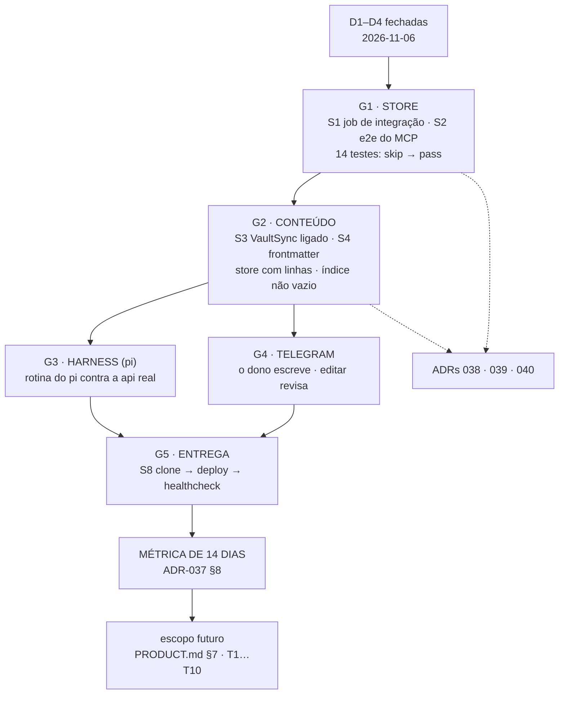

# ikigai — ROADMAP

**Feature id:** `production-readiness`
**Data:** 2026-11-09 (remedição; a primeira versão é de 2026-11-06)
**Estado:** execução — as decisões D1–D4 estão fechadas; os gates G1–G5 são a sequência
**Âncora:** [`PRODUCT.md`](./PRODUCT.md) (o que é e em que estado) · [`TECH.md`](./TECH.md) (o plano e os PASS)
**Código medido:** `506f406a` (box, PR #47) · **remedição de 2026-11-09**: store com 1 974 artefactos

> Este documento liga a **árvore de planeamento** (o que existe e o que falta
> em cada nível), o **grafo de dependências** (o que tem de vir antes do quê) e
> os **gates** (os ensaios que fecham cada fase, com critério de aceitação
> falsificável).

---

## 1. A árvore de planeamento, e o buraco nela

O repositório tem um meio forte e duas pontas vazias. A tabela diz o que há em
cada nível da hierarquia SDD e o que falta.

| Nível | Pergunta que responde | Documento | Estado |
|---|---|---|:-:|
| **BRD** | *porquê este produto, para quem, e o que decide se funcionou* | **não existe como documento** | ⛔ |
| **PRD** | *o que o produto faz, e como se sabe que faz* | [`PRODUCT.md`](./PRODUCT.md) (novo, 2026-11-06) — as invariantes `B1`–`B10` e a matriz de prontidão | 🆕 |
| **SPEC** | *o comportamento observável, numerado* | a série de 2026-11-01: [`00`](../../docs/superpowers/specs/2026-11-01-00-data-layer-series.md) · [`01 DOM`](../../docs/superpowers/specs/2026-11-01-01-unified-dom.md) · [`02 Store`](../../docs/superpowers/specs/2026-11-01-02-cloud-store.md) · [`03 Service+Transporte`](../../docs/superpowers/specs/2026-11-01-03-service-transport-pi.md) — ⚠️ **escrita antes do corte**: cita `sys_ikigai/`, `src/mesh/` e `interfaces-cli`, que já não estão publicados | ⚠️ |
| **ADR** | *que decisão foi tomada, e o que ela eliminou* | [`011`](../../code-docs/adr/ADR-011-ikigai-mcp-http-sse-transport.md) · [`013`](../../code-docs/adr/ADR-013-canonical-scope-discipline.md) · [`014`](../../code-docs/adr/ADR-014-ueid-canonical-format.md) · [`033`](../../code-docs/adr/ADR-033-ueid-single-source-mandate.md) · [`037`](../../code-docs/adr/ADR-037-data-layer-canonical-turn.md) | ✅ |
| **TECH** | *como se constrói, com que ordens e que provas* | [`specs/data-layer/TECH.md`](../data-layer/TECH.md) (2026-11-01) · [`specs/production-readiness/TECH.md`](./TECH.md) (novo) | ✅ |
| **Tasks** | *o que se executa, em que ordem, com que aceitação* | **não existe como artefacto** — vive no §9 do `TECH.md` e neste ficheiro | ⛔ |

### 1.1 O buraco do topo: o BRD

O BRD não foi escrito. As suas peças existem dispersas:

| Peça do BRD | Onde está hoje | Falta |
|---|---|---|
| A tese do produto | [`README.md`](../../README.md) §1 · ADR-037 | uma afirmação única de **para quem** e **que problema resolve** |
| A métrica que decide | ADR-037 §8 — as três métricas dos 14 dias | está numa ADR, não num BRD |
| As prioridades em PT-BR | `vault/_strategics_excerpt.md` (Vida > Trabalho, RECOVER > PUSH, anti-padrões) | está num ficheiro de vault, não num BRD |
| O utilizador e o momento | [`PRODUCT.md`](./PRODUCT.md) §1 | ✅ (nasceu hoje) |
| O que o produto **não** é | [`PRODUCT.md`](./PRODUCT.md) §5 | ✅ (nasceu hoje) |

**A acção**: `specs/product-brief/PRODUCT-BRIEF.md` — curto, com a métrica no
topo. **Não é um pré-requisito da execução**: o BRD organiza a história, não
trava o código.

### 1.2 O buraco do meio: a série de specs é anterior ao corte

A série `2026-11-01-0{0..3}` é a especificação de comportamento do DOM, do
store e do transporte — e é **o que o `TECH.md` de 2026-11-01 prometeu**. Mas
foi escrita antes do corte de âmbito e cita árvores que já não estão
publicadas (`sys_ikigai/`, `src/mesh/`, o entry `interfaces-cli` do CI).

**A acção**: reescrever a série em cima do que existe, ou marcá-la como
histórico e deixar o `PRODUCT.md` (invariantes `B1`–`B10`) ser a especificação
vigente. **Recomendação**: a segunda — a série é um documento datado de uma
decisão datada, e ADR-037 §"publicação independente" diz que isso é história,
não arquitectura.

### 1.3 O buraco de baixo: as Tasks

O `TECH.md` §9 tem os nove passos com PASS. O que falta é o artefacto que os
transforma em trabalho executável — com dependências, dono e ordem.

**A acção**: `specs/production-readiness/TASKS.md`, gerado a partir do §9 do
`TECH.md`, com uma entrada por passo (`S1`…`S9`), o PASS, os ficheiros que
toca e a dependência. **Formato**: a convenção SDD — cada task cabe numa
sessão, tem um objectivo, entradas, saídas e uma verificação.

### 1.4 As ADRs que faltam

| ADR | Decisão | Porquê merece ADR |
|---|---|---|
| **ADR-038** | **O store é single-player.** O `client_id` é rótulo de auditoria, não isolamento; as políticas de RLS ficam inertes e declaradas | muda o que o store **promete** (D1) — e a promessa é o que o ADR-037 D5 construiu |
| **ADR-039** | **A semântica sai do contrato v1** até haver provider; o MCP passa a ter 5 tools | muda o **contrato público** do transporte (D2) |
| **ADR-040** | **A âncora de identidade do cliente Telegram é o `message_id`, carried no 3.º segmento do UID** | toca o formato do UID (ADR-014) e decide se o bot revisa ou duplica (D3) |
| ~~ADR-041~~ | ~~o store prova-se no CI~~ | **não é ADR** — é engenharia; vive no `TECH.md` §7 e §9 (D4) |

---

## 2. O grafo



**As dependências que não se podem quebrar:**

- **G1 antes de tudo.** Sem um Postgres real, cada passo seguinte é testado
  contra dublês — que é o que a suite faz hoje, e é por isso que 150 testes
  verdes não provam o produto.
- **G2 antes de G3 e G4.** O `pi` e o Telegram escrevem no mesmo store; se o
  store nasce vazio e sem grounding, os dois vão "funcionar" e não vão
  encontrar nada.
- **G3 e G4 em paralelo.** São clientes diferentes do mesmo api; nenhum
  depende do outro.
- **G5 antes da métrica.** A métrica de 14 dias mede um sistema em produção
  daily; um sistema que só existe numa máquina não a mede.
- **A métrica antes de T1…T10.** ADR-037 D1: a camada algorítmica vem depois
  dos dados, e os dados vêm depois de o sistema estar vivo.

---

## 3. Os gates

Cada gate tem: o que se faz, o **critério de aceitação** (falsificável), o
que conta como falha, e a variante manual (para o VPS, quando o box voltar).

### G1 · Store — *o Postgres real aceita o schema e o repositório relê*

| | |
|---|---|
| **Onde** | job novo no CI (`integration-stack`), com Docker do runner |
| **Passos** | `docker build` → `compose up -d db api` → `apply up` → healthcheck → os 14 testes de `tests/store/` |
| **Critério de aceitação** | **os 14 testes passam** (hoje: `skipped`) **e** `python -m src.transport.healthcheck` sai 0 |
| **Falso positivo** | "passou" com `skipped` — o job tem de **falhar** se algum teste saltar |
| **Falsificação** | remover o `services:`/Docker do job ⇒ os testes saltam ⇒ o job falha |
| **Manual (VPS)** | `docker compose up -d --build` · `docker compose exec api python -m src.contracts.migrations.apply up` · `docker compose exec api python -m src.transport.healthcheck` |
| **Invariantes** | B1, B2, B3 |

### G2 · Conteúdo — *a prosa entra e o grounding chega*

| | |
|---|---|
| **Onde** | CI, com o stack de G1 a correr |
| **Passos** | ingestionar o `vault/` → `search_artifacts` → carregar os `strategics/` |
| **Critério de aceitação** | (a) `search_artifacts` devolve um artefacto cujo `body_hash` é o hash de um ficheiro conhecido do vault; (b) `load_strategics(<raiz real>)` devolve **9 documentos** e o `index` não está vazio |
| **Falso positivo** | um teste com fixtures inventadas a passar — o teste tem de apontar para o **corpus publicado** |
| **Falsificação** | remover o `tags:` de um `strategics/*.md` ⇒ o índice perde-o ⇒ o teste falha |
| **Invariantes** | B8, B9 |
| **Medido em 2026-11-09** | **(a) PROVADO** — 1 974 artefactos (1 953 com `vault_path` — os 21 restantes são os que o `pi` escreveu hoje), `sha256(ficheiro)` = `body_hash` em 40/40, e a search devolve o artefacto com o hash do ficheiro. **(b) FALSIFICADO** — `load_strategics` devolve **0 documentos** e índice **vazio**: os 9 ficheiros não têm frontmatter, e o loader filtra por `tags:` contendo *"strategic"*. O gate **não fecha** até isto ser corrigido (§5.1) |

### G3 · Harness — *o `pi` corre uma rotina de verdade*

| | |
|---|---|
| **Onde** | a máquina do dono (o `pi` está instalado) ou o VPS, por túnel SSH — `.pi/mcp.json` aponta para `http://127.0.0.1:8000/mcp` |
| **Passos** | `pi mcp list` (tem de mostrar o servidor `ikigai` e as suas 5–6 tools) → `pi -p "<prompt da rotina>" --mode json` → o store |
| **Critério de aceitação** | por rotina: o artefacto do **tipo** certo existe no store, com os **campos que o tipo exige** |
| **Detalhe por rotina** | `daily-note` ⇒ uma `nota` · `weekly-review` ⇒ uma `revisao` · `monthly-review` ⇒ uma `desc` **com `rationale`** (a skill exige as duas linhas) · `quarterly-plan` ⇒ `plano` + `fase` + `okr` + `onda`, ligados por `parent_of`/`derives_from` |
| **Falso positivo** | o agente responder em prosa sem chamar tool nenhuma — o critério é a **tool chamada** e a **linha no store**, não a resposta |
| **Falsificação** | apontar `.pi/mcp.json` para uma porta errada ⇒ `pi mcp list` tem de mostrar o erro, e o gate tem de reprovar |
| **Invariantes** | B10, B1 |
| **Medido em 2026-11-09** | **`daily-note` PROVADO** — correu no box, escreveu a `nota` do tipo certo (`not:2026-11-09:74dfed05:…`), revisão 1→**4**, com o corpo a citar o plano ingerido. **`weekly-review` PROVADO** — escreveu a `revisao` `rev:2026-w45:03d48a5c:2bcfa8fa6c363cc2` (`kind=revisao`, `quarter=Q4-2026`, `status=closed`, rev **1**), com **todos** os campos que o tipo exige e arestas `references` → o plano trimestral. **`monthly-review` PROVADO** — escreveu a `desc` `des:revisao-mensal-q4-2026:a68c4ee7:af5237c5596d44d4` (22:24:09Z): `kind=desc`, `quarter=Q4-2026`, rev **1**, `status=provisional`, com **`decision` e `rationale` preenchidos** em `ikig.artifact_decs` e **16 arestas `references`** na mesma transação (§5.4). **`quarterly-plan` PROVADO** — escreveu **5 `fase`**, **5 `okr`** (com `objective` **e** `key_result` preenchidos em `ikig.artifact_okr`, 5/5) e **7 `kpi`**, todos com `quarter=Q4-2026`, ligados por `parent_of`/`derives_from` — mas **com o `parent_of` invertido** (§5.5), e **sem `onda`**: as 6 `onda` do store são as ingeridas do vault e nenhuma tem uma aresta |

### G4 · Telegram — *o dono escreve do telefone, e editar revisa*

| | |
|---|---|
| **Onde** | o bot no VPS (o token e a allowlist vivem em `deploy/.env`) |
| **Passos** | `/nota <título>` → o store → o `pi` relê |
| **Critério de aceitação** | (a) a nota existe com `revision = 1`; (b) **editar a mensagem produz `revision = 2` e UM artefacto** (hoje duplica); (c) `/desc` com uma linha → o bot **pergunta a segunda e não escreve nada**; com duas linhas → escreve a decisão com a `rationale`; (d) `/busca` devolve a nota |
| **Falso positivo** | "o bot respondeu bem" — o critério é o **estado no store**, não a resposta do bot |
| **Falsificação** | repor `expected_revision: None` ⇒ editar duplica ⇒ o gate reprova |
| **Invariantes** | B1, B2, B10 |

### G5 · Entrega — *um clone vira um serviço*

| | |
|---|---|
| **Onde** | o VPS |
| **Passos** | `git clone` → `bash scripts/deploy-vps.sh main` → healthcheck |
| **Critério de aceitação** | healthcheck verde **sem intervenção humana**, a partir de um clone limpo, e o `db-data` com **dump antes** do `up` novo |
| **Falso positivo** | "funciona na minha máquina" — o critério é um clone **limpo**, num directório novo |
| **Falsificação** | trocar o script por uma versão sem dump ⇒ o teste de rollback falha |
| **Invariantes** | — |

---

## 4. A sequência

Três ondas. Cada onda tem um PASS próprio e pode ser mergeada sozinha.

| Onda | Passos | Leva | PASS da onda |
|---|---|---|---|
| **O1 · Provar o store** | S1, S2 (+ I9, I10, I11) | o CI passa a ter Docker e a provar o Postgres | **os 14 testes do store passam no CI** |
| **O2 · Encher e ancorar** | S3, S4, S7 (+ ADR-038) | o vault entra, o grounding chega, o contrato deixa de prometer isolamento | **o store tem linhas do vault e o índice não está vazio** |
| **O3 · O dono escreve** | S5, S6, S12 (+ ADR-039, ADR-040) | o bot revisa, a semântica sai, o cliente tem timeout | **editar no Telegram revisa em vez de duplicar** |
| **O4 · Entregar** | S8, S9 (+ ADR-040) | o deploy passa a ser do branch | **clone → serviço, sem mão** |

**O porquê desta ordem**: a O1 é a única que desbloqueia a verificação de todas
as outras. A O2 é a que dá conteúdo ao produto. A O3 é a que fecha a promessa
do conflito (B2). A O4 é a que torna o sistema repetível. E a **métrica de 14
dias** vive depois da O4.

---

## 5. Critérios de aceitação do produto

As invariantes do `PRODUCT.md` §2, mapeadas no gate que as prova. A coluna
**hoje** é a medição de **2026-11-09**, feita no box do dono e **pelo caminho
real** — MCP sobre HTTP, o vault como está montado, o store como está. O que
não foi remedido hoje está marcado como tal; a coluna não diz "provado" por
herança.

| Invariante | Gate | Critério de aceitação | Hoje |
|---|:-:|---|:-:|
| **B1** nota escrita no Telegram existe no store e é relida pelo `pi` | G1, G3, G4 | o artefacto existe com o tipo certo, a revisão certa e o corpo lido de volta | **provado** — `not:2026-11-09:74dfed05:d6ad7bd8023c5f59`: nota criada na sessão do dono (`tg-2115322359`, 01:31:44Z), relida e revista pelo `pi` (revisão 4, `read_at` 13:12Z), corpo a citar o plano ingerido |
| **B2** zero escritas perdidas; revisão obsoleta = 409 | G1, G3, G4 | duas escritas concorrentes com a mesma revisão ⇒ **1× 409, 0 sobrescrita** | **provado** — `expected_revision=1` em duas escritas concorrentes: 1 aceite (revisão 2), 1 recusada (*"expected_revision is stale — reread and reapply"*); corpo final = um dos dois, **0 sobrescritas** |
| **B3** idempotência | G1 | a mesma `idempotency_key` duas vezes ⇒ **uma** escrita | provado em memória (não remedido hoje) |
| **B4** o cliente falha fechado | G3, G4 | sem `IKIGAI_BOT_ALLOWED_CHAT_IDS` o bot **não arranca** | provado (não remedido hoje) |
| **B5** o bot nunca abre a base de dados | G4 | o bot não tem DSN no compose e fala MCP | provado (não remedido hoje) |
| **B6** o transporte nunca transporta SQL | G1, G3 | zero `select\|insert\|update\|delete` em `mcp_server.py` | provado (não remedido hoje) |
| **B7** o healthcheck mede o plano de dados | G1 | a inserção de sonda passa (ou é recusada pela RLS) — nunca `select 1` | provado (não remedido hoje) |
| **B8** a prosa entra pelo vault e sai como linhas tipadas | G2 | uma linha por ficheiro ingerido, com o `body_hash` certo | **provado** — 1 974 artefactos (1 953 com `vault_path`; os 21 restantes são os que o `pi` escreveu hoje, sem `vault_path`); `sha256(ficheiro)` = `body_hash` em **40/40**; e a `search_artifacts` devolveu o artefacto cujo `body_hash` é o do ficheiro |
| **B9** o grounding estratégico chega ao agente | G2, G3 | o índice tem os 9 documentos e o agente os cita | **parcial** — o *agente* cita o grounding (o "AG3" vive no `pln:deep-agent-build-q4-2026:…`), mas o caminho escrito **falha**: `load_strategics` devolve **0 documentos** e índice **vazio** (§5.1) |
| **B10** a cadência produz o artefacto do seu tipo, com os campos que o tipo exige | G3 | o `pi` produz uma `desc` com `rationale`, um `okr` com `key_result` | **provado** — a `desc` `des:revisao-mensal-q4-2026:a68c4ee7:af5237c5596d44d4` (22:24:09Z, rev 1) tem `decision` **e** `rationale` preenchidos em `ikig.artifact_decs`, e 16 arestas `references`; e os 5 `okr` do `quarterly-plan` têm `objective` **e** `key_result` preenchidos em `ikig.artifact_okr` (5/5). A cadência correu — a entrada `/v1/routine` é que esteve recusada enquanto a sessão do dono tinha outro turno (§5.4) |

**Contagem**: **9 provadas** (5 delas remedidas hoje) · **1 parcial** · **0 não
provadas**. Antes (2026-11-06): 5 · 3 · 2. **Depois da O4**: 10 provadas, e o
único teste que falta é o dos 14 dias.

### 5.1 A remedição de 2026-11-09: o que foi medido, e como

Tudo pelo caminho real: o **MCP sobre HTTP** (as seis tools do ADR-011,
`tools/list` lido do próprio servidor), o **vault como está montado** no
contentor (`/app/zonas` com 2 551 ficheiros), e o **store como está** (1 974
artefactos, 10 páginas de `search_artifacts`).

**O que o `body_hash` é, lido do código que corre** (`src/services/sync.py`):
`content = path.read_text("utf-8")` · `body_hash = sha256(content)`. A regra é
reproduzível fora do store — e por isso é verificável.

**O que ficou provado:**

| Medida | Resultado |
|---|---|
| B8 · hash do ficheiro = `body_hash` | **40/40** conferidos, 0 divergências |
| B8 · a search devolve o artefacto certo | 1 hit, `body_hash` **igual** ao do ficheiro |
| B2 · escritas concorrentes | 1 aceite · 1 recusada · **0 sobrescritas** |
| B1 · a nota do dono relida pelo `pi` | revisão **4**, `opened_at` 01:31:44Z → `read_at` 13:12Z |
| B10 · a `revisao` do `weekly-review` | `rev:2026-w45:03d48a5c:2bcfa8fa6c363cc2` — rev **1**, `kind=revisao`, `quarter=Q4-2026`, `status=closed`, **todos** os campos que o tipo exige, e arestas `references` → o plano trimestral |
| B10 · a `desc` do `monthly-review` | `des:revisao-mensal-q4-2026:a68c4ee7:af5237c5596d44d4` — rev **1**, `kind=desc`, `quarter=Q4-2026`, `status=provisional`, `decision` **e** `rationale` preenchidos em `ikig.artifact_decs`, **16 arestas** `references` |
| B10 · os `okr` do `quarterly-plan` | **5/5** com `objective` **e** `key_result` preenchidos em `ikig.artifact_okr` — e 7 `kpi` com `metric`, `target`, `period` e `direction` em `ikig.artifact_kpi` |

**O que ficou FALSIFICADO — e é uma correcção a fazer:**

> **G2 (b) é falso hoje.** `load_strategics(<raiz real>)` devolve **0
> documentos** e um índice **vazio** — os 9 ficheiros de `strategics/` estão lá,
> mas **nenhum tem frontmatter**, e o loader filtra por `tags:` contendo
> *"strategic"*. O critério do gate pede 9 documentos e um índice não vazio.
>
> O grounding **chega** ao agente por outro caminho — o `plano` trimestral
> ingerido (`02-q4-2026/01-plano-trimestral/deep-agent-build-q4-2026.md`),
> que é onde o "AG3" vive. Mas o caminho **escrito** no gate não funciona, e
> um gate que não funciona é um gate que não prova nada.
>
> **A correcção:** dar frontmatter `tags: [strategic]` aos 9 ficheiros — ou
> alinhar o filtro do loader com o que o gate promete. Uma das duas; e um
> guard que conte os documentos.

**O que ficou à espera do dono (e porquê):**

O `daily-note` correu e escreveu; o `weekly-review` também — depois de as
perguntas expirarem sem resposta, o agente seguiu com a **leitura dele** (a
W45, a semana fechada que ainda não tinha revisão) e escreveu a `revisao`. O
`monthly-review` fez o mesmo: **dez** perguntas expiradas, e escreveu a
`desc` com os gaps calculados a partir do store. As perguntas ao dono são o
HITL a funcionar (ADR-041), não uma falha:

| Rotina | Pergunta | Opções | Como ficou |
|---|---|---|---|
| `weekly-review` | que semana cobrir: a W45 (fechada, sem revisão registada) ou a W46 (a correr)? | W45 · W46 | expirou (19:21:10Z) · o agente escolheu a W45 e escreveu a `revisao` |
| `weekly-review` | o gate AG3 (MERGE ou DISCARD do gateway órfão) sai do plano ou permanece, vencido? | Sai do plano · Permanece (not started) | expirou (19:25:21Z) · o agente seguiu com a leitura dele |
| `monthly-review` | que janela cobrir: Outubro de 2026, o Q4-2026 até agora, ou Novembro em curso? | Outubro · Q4 até agora · Novembro | expirou **4 vezes** (20:22:48Z, 21:29:53Z, 21:42:21Z, 21:58:31Z) · o agente seguiu com a leitura dele e escreveu a `desc` (§5.4) |
| `monthly-review` | os gaps de B0–B2 estão ou não registados? | NÃO FEITO · FEITO e não registado · Misturado | expirou **4 vezes** (21:29:53Z, 21:42:23Z, 21:58:29Z, 22:14:46Z) · o `pi` calculou os gaps **a partir do store** e escreveu-os na `rationale` |
| `quarterly-plan` | rodar o Teste de Fogo contra o Q3-2026, ou corrigir o trajeto do Q4-2026 sem quarter novo? | A — Teste de Fogo · B — Correção do Trajeto | **respondida** às 20:01:30Z: *"B — Correção do Trajeto do Q4-2026: materializar o plano vigente, sem quarter novo"* — **a resposta chegou depois de a rotina já ter morrido** (§5.2) |
| `quarterly-plan` | o split das ondas: 3 ondas (a estratégia) ou 1 onda (o plano vigente)? | 3 ondas · 1 onda | **sem resposta** — perguntada **5 vezes** (21:22:00Z, 22:27:17Z, 22:43:03Z, 22:58:11Z, 01:33:08Z) e as 5 expiraram (§5.4) |
| `quarterly-plan` | o gate AG3 (gateway órfão) sai do plano ou permanece, vencido? | Sai do plano · Permanece | **respondida** às 22:41:26Z: *"A — MERGE: cherry-pick para branch limpa e rodar os testes"* — a decisão ficou registada numa `desc` (§5.4) |

A pergunta suspende a chamada da ferramenta do agente até haver resposta
(prazo: **15 minutos**), e a resposta é o botão no Telegram. O HITL está
**provado ponta a ponta**: a pergunta do `quarterly-plan` chegou ao Telegram
do dono e ele respondeu. O que vem **depois** da resposta também está medido:
o `pi` acordou a resposta às 22:28Z — *"the owner answered question
7ec59cfd6e6b earlier: 'B — Correção do Trajeto do Q4-2026'"* — e continuou a
rotina com ela. O que ficou por medir é o que vem **sem** resposta: a `onda`
do quarter (§5.3).

### 5.2 A incoerência dos tetos: porque é que uma rotina que pergunta não podia terminar

Medido no box em 2026-11-09, e corrigido no PR #43.

**O sintoma.** O `monthly-review` morreu aos **302 s** com *"fetch failed"*, e
o contentor estava de pé há **58 minutos** — sem deploy nenhum. O `pi`
continuou a trabalhar: a pergunta foi feita às 20:22:48Z, o agente juntou
evidência até 20:41:53Z, e o trabalho **foi para o lixo** porque o dono nunca
soube.

**Os três tetos, e o que eles diziam:**

| teto | onde | valor | o que permitia |
|---|---|---|---|
| o prazo da pergunta ao dono | `HARNESS_OWNER_TIMEOUT_MS` | 900 s | o agente espera 15 min pela resposta |
| o prazo da rotina | `HARNESS_TIMEOUT_MS` | 600 s | a rotina morre aos 10 min |
| o socket do bot | `IKIGAI_HARNESS_TIMEOUT_S` | 630 s | o bot espera 10 min e meio |

**A rotina morria antes de a pergunta expirar.** Uma rotina que pergunta ao
dono não podia, por construção, esperar pela resposta: o prazo da rotina era
menor do que o prazo da pergunta. É a incoerência que o PR #43 corrige — o
prazo da rotina passa a ser **derivado** do prazo da pergunta
(`OWNER_TIMEOUT_MS + 5 min`), e o socket do bot a esperar mais do que isso.

**O "fetch failed" não era do servidor.** O isolamento (três casos, o mesmo
handler, a mesma demora de 310 s, no Node 24 do próprio box) diz quem matou:

| caso | servidor | cliente | resultado |
|---|---|---|---|
| A | `requestTimeout` por omissão | `http` cru (sem timeout) | **OK aos 310,1 s** — o default do servidor *não* corta a resposta |
| B | `requestTimeout = 0` | `http` cru | **OK aos 310,1 s** |
| C | `requestTimeout = 0` | `fetch` (o undici tem `headersTimeout` de 300 s) | **FALHOU aos 301,0 s** (`UND_ERR_HEADERS_TIMEOUT`) |

O limite de 300 s vinha do **cliente** — e o prazo do cliente nunca foi
próprio do produto para fixar. O que o produto é dono é a **ordem dos seus
próprios tetos**, e era essa ordem que estava errada.

**Um segundo defeito, medido na mesma noite (corrigido no PR #45).** A sessão
do dono tem um turno de cada vez, e o harness recusa o segundo pedido com
*"Agent is already processing"* — recusa **correcta**, mas o `finally` do
pedido recusado põe `busy = false` no turno que **está a correr**. O reaper
(15 min sem uso) viu a sessão como livre e **matou o `pi` a meio do
trabalho**, às 20:41:59Z — o agente estava a escrever nesse momento.

O PR #45 troca a flag por uma **contagem**: a sessão conta os turnos em curso,
e o reaper, a evictação e a sondagem olham para a contagem. A recusa
**continua** a ser uma recusa (502) — o que muda é que já não mata o turno
que está a correr.

**Fica por decidir:** se a segunda rotina deve **esperar a sua vez**. A
sessão tem `entry.chain` (`server.mjs:432`) desde o início: a serialização
está desenhada e não está implementada. Implementá-la muda o contrato de
concorrência — é decisão do dono. **Essa decisão já tem medição**, na
subsection seguinte.

#### O contrato de concorrência, medido

Medido em 2026-11-10, 11:44:41Z–11:45:27Z, no box do dono, pela porta real
(`POST /v1/routine` — o mesmo caminho que o bot usa).

**O A/B.** Duas rotinas `store-read` na **mesma** sessão `probe-conc-1`, a
segunda **4 s** depois da primeira. `store-read` é read-only: escreve zero
artefactos, zero relações e zero ficheiros.

| | pedido A (o primeiro) | pedido B (4 s depois) |
|---|---|---|
| resposta | **HTTP 200**, `ok: true`, 46 201 ms | **HTTP 502**, recusado |
| a causa | — | *"Agent is already processing. Specify streamingBehavior ('steer' or 'followUp') to queue the message."* |
| os eventos | `routine.started` → `routine.finished` | `routine.started` → `routine.failed` |
| o store | 0 escritas | 0 escritas |

**O que a medição acrescenta ao que se sabia.**

1. **A recusa é do SDK, não do harness.** A mensagem é a do `pi`, e o harness
   transforma-a em 502 (`server.mjs:715`). **Não há guarda no harness**:
   `entry.chain` (`server.mjs:432`) existe desde o início e **nunca é lido nem
   escrito** — a serialização está desenhada, não implementada. O que recusa
   hoje é um **acidente do SDK**, não um contrato declarado.
2. **A recusa é rápida e não toca no turno que está a correr.** B foi recusada
   **2 552 ms** depois do seu próprio `routine.started`; o health respondeu
   `live_sessions: 1, busy_sessions: 1` em **todas as 23 sondas** dos ~44 s de
   sobreposição, e A terminou normal (200, 46 201 ms). ⇒ A contagem de turnos
   (PR #45) aguenta uma recusa real: recusar **não** liberta o turno em curso.
3. **O log over-declara arranques.** O pedido recusado também escreve
   `routine.started`: o log conta **2 arranques** e **1 acabamento**. Quem
   conta rotinas pelo log vê mais do que existiu.
4. **A recusa nomeia as alternativas — e o SDK diz o que elas fazem.** Na
   type-definition do próprio pacote
   (`/app/harness/node_modules/@earendil-works/pi-coding-agent/dist/core/agent-session.d.ts`):
   `streamingBehavior: "steer" | "followUp"`, *"when streaming, how to queue the
   message: `steer` (interrupt) or `followUp` (wait)"*; e o cliente RPC expõe
   `followUp()` — *"queue a follow-up message to be processed after the agent
   finishes"*. ⇒
   **"esperar a vez" já existe como primitiva do SDK** e não precisa de
   `entry.chain`. Mas `promptAndWait(message, images?, timeout?)` **não tem**
   `streamingBehavior`: com a chamada de hoje, o harness só pode ser recusado.

**As três opções, e o que cada uma custa.**

| opção | o que o dono vê | o que a medição diz |
|---|---|---|
| **recusar** (o que o produto faz hoje) | 502 em ~2,5 s, e o pedido é reenviado | é o que está medido e **funciona**: o turno em curso não é tocado, o health não mente, o store fica intacto. A fraqueza: a mensagem é a do **SDK**, em inglês, e não diz ao dono o que fazer |
| **esperar a vez** (`followUp`, ou `entry.chain`) | nada durante a espera; a resposta depois | serializa de facto — o `followUp` do SDK **é** a fila, e há primitivas para a esperar (`collectEvents`, `waitForIdle`). O custo é o do §5.2: **um pedido que espera é um pedido que expira sem o dono saber**; e o pedido entra na **mesma sessão**, já com o contexto da rotina anterior |
| **steer** | a 2.ª mensagem entra no turno em curso | é *"interrupt"* na type-definition do SDK: muda o que a 1.ª rotina está a fazer, a meio da escrita. Numa loja em que a escrita tem de ser **uma por artefacto, com revisão**, isto é **fora de questão** |

**A recomendação da casa: recusar — mas recusar *declarado*.** O harness deve
recusar **antes** de chamar o `pi`, com uma mensagem que diga o que está a
acontecer e o que fazer; e o `/v1/health` deve dizer que a sessão está
ocupada. O precedente está medido no §5.2: o `monthly-review` morreu aos 302 s
sem que ninguém soubesse — o que mata o dono não é a espera, é o silêncio.

**A escolha foi: recusar declarado** (dono, 2026-11-10). E o que isso
significa, medido no código:

| | antes | agora |
|---|---|---|
| quem recusa | o SDK do `pi` (*"Agent is already processing…"*), por acidente | o harness, **antes** de chamar o `pi` |
| o que o dono lê | a frase de um terceiro, sobre um parâmetro que ele não tem | *"a rotina foi recusada — a sessão já tem outra rotina a correr. Espera que ela termine e pede outra vez."* |
| o status | 502 (uma falha) | **409** (um conflito com o estado da sessão) |
| o log | `routine.started` + `routine.failed` — **2 arranques, 1 acabamento** | `routine.refused` — **0 arranques** |
| a sessão ocupada | ninguém a podia ver | o `/v1/session` diz `busy: true` |

O contrato vive em `deploy/harness/refusal.mjs` (uma função pura, testável
sem agente e sem base de dados) e o guard em
`deploy/harness/test/refusal.test.mjs` prende a frase: **é do produto, não é
a do SDK**. Do lado do cliente, o `HarnessError` transporta o status — sem ele
"recusada" e "falhou" eram a mesma frase — e o guard em
`test_bot_harness_refusal.py` prende a frase do dono.

### 5.3 O que a medição deixou por medir

**O `monthly-review` e o `quarterly-plan` já não estão à espera.** O
`monthly-review` escreveu a `desc` às 22:24:09Z, depois de **dez** perguntas
expiradas sem resposta; o `quarterly-plan` escreveu as 5 `fase`, os 5 `okr` e os
7 `kpi`, com os campos tipados preenchidos (§5.4, §5.5).

**O que fica por medir — as `onda` do quarter.** As 6 `onda` que existem no
store são as **ingeridas** do vault (`ond:placeholder:*` — 3 de Q3-2026, 3 de
Q4-2026). As 3 do Q4 **têm** 4 arestas, mas são todas **de entrada** (3
`evidences` da nota de 2026-11-09 e 1 `references` da revisão da W45): a rotina
nunca as materializou, e o `pi` perguntou ao dono se o quarter leva 3 ondas ou 1
(§5.1) — **5 vezes**, e as 5 expiraram (§5.4). O `plano` do quarter também
**não foi escrito** pela rotina: o dono escolheu *"B — materializar o plano
vigente, sem quarter novo"*, e o plano vigente é o que já lá estava, ingerido
(`pln:deep-agent-build-q4-2026:bd40d7ab:…`, criado a 2026-11-09 00:23:19Z).

**E há uma condição do ambiente que a medição não controla.** O box é
redeployado por outra sessão, e cada recriação de contentor **mata a rotina a
meio**: o agente vive dentro do contentor. Medido em 2026-11-09 e 2026-11-10 —
**cinco** medições mortas, e o histórico do workflow `Deploy` diz quando:

| rotina | de → até | o que a matou |
|---|---|---|
| `monthly-review` | 20:21:55Z → 20:26:57Z | o socket do **cliente** (o `fetch` do probe morre aos 300 s) — o agente continuou a trabalhar até o reaper o matar, às 20:41:59Z |
| `monthly-review` | 20:59:27Z → 21:12:37Z | a **recriação do contentor** por um deploy alheio (o box passou ao `c904d870`) |
| `quarterly-plan` | 21:12:37Z → 22:00:06Z | **não foi morto** — o turno continuou **48 minutos** depois de a rotina ser abandonada pelo harness (§5.4) |
| `monthly-review` (G6, pela **entrada do produto**: `POST /v1/routine`) | 04:37:46Z → 04:53:5xZ | o deploy `f3db3046` (PR #51), **04:53:52Z → 04:57:06Z** — o contentor foi recriado **antes** do prazo da pergunta (04:58:38Z), e um segundo deploy, `b75478bf` (PR #53, **05:14:57Z → 05:18:14Z**), levou os logs do contentor anterior (§5.4) |

O que **sobrevive** ao deploy é o store (o `memory.sqlite` é um volume) e o
ficheiro de sessão do `pi` (o `harness-state` é um volume). O que não
sobrevive é o **turno**: o processo do agente vive no contentor.

**A lição para a próxima medição:** um gate que depende de um agente que
pergunta ao dono **precisa de uma janela sem deploys** — e de alguém que
responda. Sem as duas coisas, o gate mede a disponibilidade do box, não o
produto.

### 5.4 A sessão do dono não largou o turno — e o healthcheck não viu

Medido em 2026-11-09, entre 21:12Z e 22:35Z; a janela do dono foi seguida até
2026-11-10T04:58Z (o HITL), o A/B da expiração correu às 05:10Z e o A/B do
tecto da rotina às 05:25Z.

**O sintoma.** O `monthly-review` invocado por `/v1/routine` foi **recusado
6/6 vezes** com *"Agent is already processing"*; o `quarterly-plan`, **6/6
outras**. 450 s por rotina, **12 recusas** com o mesmo padrão.

**A causa, medida.** A sessão do dono (`tg:2115322359`) tem **um turno de cada
vez**, e o turno em curso era o `quarterly-plan`, que começou às 21:12:37Z. O
`pi` **continuou a trabalhar depois de o harness desistir**: escreveu os `okr`
e as `fase` às 22:00:06Z — **48 minutos** depois de a rotina já ter sido
abandonada — e o ficheiro de sessão (um volume) ainda crescia às 22:31:58Z:
708 linhas, 3,8 MB.

**O healthcheck dizia o contrário.** `/v1/health` respondia `live_sessions: 1,
busy_sessions: 0` — o harness **não sabia** que o `pi` estava ocupado, porque o
seu mapa de sessões vive na memória do contentor e um deploy o repõe (o
contentor do harness nasceu às 21:54:44Z). O contador de turnos do PR #45 conta
os turnos que **o harness** conhece; o turno que **o `pi`** segura sobrevive ao
deploy.

| o que se mediu | valor |
|---|---|
| recusas de `/v1/routine` (502) | **12** na primeira janela (6 `monthly-review` + 6 `quarterly-plan`); a segunda janela (40 tentativas, uma por minuto) só somou recusas |
| o `pi` a trabalhar depois da rotina morrer | **48 min** (21:12:37Z → 22:00:06Z) |
| o ficheiro de sessão a crescer | 708 linhas · 3,8 MB · a escrever às 22:31:58Z |
| `busy_sessions` no health | **0**, com a sessão ocupada |
| perguntas ao dono, na sessão `tg-2115322359` | **18** em 9 h 12 min (19:40:15Z → 04:52:38Z): **2** respondidas, **16** expiradas |

**O que o `pi` fez, e está certo.** A regra do tool `ask` é explícita: *"The
owner did not answer in time. Continue with your best reading and say that the
owner did not answer."* Depois de **dez** expirações, o agente escreveu a `desc`
com a leitura do store e disse, no relatório, que o dono não respondeu. **É o
HITL a funcionar** (ADR-041) — mas custa cinco voltas de relógio por pergunta,
e a pergunta continua aberta enquanto isso.

**Uma pergunta expirada não se gasta: o `pi` volta a perguntar.** A pergunta das
ondas foi feita **5 vezes**, e as 5 expiraram. O próprio agente diz porquê, no
texto da pergunta: *"reenvio; a pergunta anterior expirou sem resposta"* (3.ª)
e *"nova tentativa; as 3 perguntas anteriores expiraram sem resposta"* (5.ª).
Cada expiração devolve o turno ao `pi`, e o `pi` abre uma pergunta nova com um
prazo novo de 15 min — **nada limita as re-perguntas**. E as `onda` continuam
por escrever, porque o skill só as materializa depois da resposta (§5.3).

| pergunta das ondas | id | prazo | como a `pi` a descreveu |
|---|---|---|---|
| 21:22:00Z | `a0c4528cd1c5` | 21:34:00Z | a primeira |
| 22:27:17Z | `01f59064dcc8` | 22:42:17Z | *"PLANO TRIMESTRAL — split das ondas"* |
| 22:43:03Z | `040225c67db2` | 22:58:03Z | *"(reenvio; a pergunta anterior expirou sem resposta)"* |
| 22:58:11Z | `1ce7997798b1` | 23:08:11Z | *"3 ondas … ou 1 onda do quarter inteiro?"* |
| 01:33:08Z | `27a239bb8520` | 01:45:08Z | *"(nova tentativa; as 3 perguntas anteriores expiraram sem resposta)"* |

**E o log de eventos pode não saber que a pergunta expirou.** A expiração não é
um timer: é observada por quem faz *polling*. `owner.read()`
(`deploy/harness/owner.mjs:136-150`) muda o estado **e regista**
`question.expired`; `owner.pending()` (`owner.mjs:200-212`) muda o estado **em
silêncio**. A/B medido no box (2026-11-10T05:10Z, sessão `probe-expiracao-ab`,
prazo de 3 s nas duas): a pergunta expirada pelo `/v1/session` deixou o log com
**1 evento** (só `question.asked`); a expirada pelo `/v1/owner/answer` deixou o
log com **3** (o `question.expired` incluído). Na sessão do dono o **estado na
base** regista **16** expirações e o **log de eventos** só **15** — a 18.ª
pergunta (prazo 04:58:38Z) está `expired` na base e **não tem evento**. O
estado é a verdade; o log subdeclara, e um contador de expirações tirado do log
não é fiável.

**E a base, pelo outro lado, também mente: o `pending` over-declara.** Medido
em 2026-11-10T12:05Z, a tabela `questions` tinha **4** perguntas em
`state = 'pending'` **com o prazo já vencido** — `71c3ebd8033d` (prazo
2026-11-09T14:07:08Z), `97ad71db4d89` (19:21:10Z), `8a342f3c4aaa` (19:36:36Z)
e `e8f3913c957c` (2026-11-10T05:20:15Z). É a mesma coisa vista do outro lado:
**a expiração é observada, não agendada** — uma pergunta só muda de estado
quando alguém a lê, e ninguém a leu. ⇒ `state = 'pending'` **não é** a lista
de perguntas em aberto. O **caminho do produto está certo** (`owner.pending()`
expira em silêncio e não devolve a pergunta, e o `/v1/session` nunca mostra uma
pergunta vencida), mas uma **consulta crua** à tabela devolve perguntas mortas
há horas — e a mais antiga estava morta há **21 h 58 min**.

**Fica por decidir (dono):** se a segunda rotina deve **esperar a sua vez**
(`entry.chain`, `server.mjs:432`, desenhada desde o início e não implementada) ou
continuar a ser **recusada com 502** — **medido em 2026-11-10: a recusa existe,
é rápida, não toca no turno que está a correr, e a própria mensagem de recusa
nomeia as alternativas** (`followUp` = fila, `steer` = interromper; §5.2, *"O
contrato de concorrência, medido"*); e se uma pergunta expirada conta como *uma*
pergunta — o `pi` perguntou **18** na sessão, e 16 expiraram — ou como *nenhuma*.

#### A janela de 2026-11-10: a entrada do produto, e o tecto que dispara

**O que a medição provou.** O `monthly-review` foi invocado pela **entrada do
produto** — `POST /v1/routine`, com um cliente HTTP cru — e não por uma
chamada interna:

| o que se mediu | valor |
|---|---|
| a rotina arrancou pela entrada do produto | **04:37:46Z** (`routine.started`, sessão `tg-2115322359`) |
| o agente trabalhou ~15 min e perguntou ao dono | **04:52:38Z** (`question.asked` `2550719e440a`, prazo **04:58:38Z** — o agente escolheu um tecto de 6 min, não os 15 do default) |
| o ficheiro de sessão do `pi` parou | **04:52:37.963Z** — **274 ms antes** de a pergunta ser registada; a última linha é o raciocínio antes do `ask` |
| o que o agente escreveu depois | **nada** — nenhuma pergunta nova, nenhum artefacto no store, nenhum `routine.finished`/`routine.failed` |

⇒ **O HITL suspende o turno, e a suspensão vê-se no ficheiro da sessão.** O
agente não "acabou" nem "falhou": ficou **pendurado na pergunta**, à espera de
uma resposta que não veio. É o comportamento certo (ADR-041) — e é a primeira
vez que a suspensão aparece pelo lado do ficheiro, e não só pelo log de
eventos.

**E o que a matou não foi o produto.** Dois deploys alheios, lidos no histórico
do workflow `Deploy` (`gh run list --workflow Deploy`): o `f3db3046` (PR #51)
entre **04:53:52Z e 04:57:06Z** recriou o contentor **antes** do prazo da
pergunta (04:58:38Z) e matou o turno; o `b75478bf` (PR #53), entre
**05:14:57Z e 05:18:14Z**, levou com ele os logs do contentor anterior. ⇒ **A
medição ficou inconclusiva** — e a lição é a de §5.3: um gate que depende de um
agente que pergunta ao dono precisa de uma janela sem deploys **e** de alguém
que responda. As duas coisas faltaram.

**O tecto da rotina, provado com um A/B.** Já que a medição morreu, mediu-se o
tecto em vez de o lamentar — e o tecto **dispara**:

| o que se mediu | valor |
|---|---|
| experimento | `POST /v1/routine` com `timeout_ms: 45000`, sessão descartável `probe-ceiling2`, rotina `store-read` |
| o `pi` foi **abatido** a meio do turno | 05:25:21Z (13 s depois do arranque) |
| o tecto disparou | **05:25:54.287Z** — `routine.failed` com *"Timeout collecting events"*, **45.003 s** depois do arranque (o limite eram 45.000) |
| o cliente recebeu | **HTTP 502** — `{"ok":false,"error":"the routine failed: Timeout collecting events…"}` |
| o health depois | `busy_sessions: 0` — o `finally` (`server.mjs:753-754`) correu e o contador desceu |

⇒ **O tecto da rotina é real.** Um agente que morre a meio não passa do tecto,
o cliente recebe um 502 **com a causa**, e a sessão fica livre. Isto fecha a
pergunta que §5.2 deixou aberta: os tectos estão **ordenados** (PR #43, PR #47)
e agora está medido que são **cumpridos**.

### 5.5 O grafo saiu de cabeça para baixo

Medido em 2026-11-09, nas escritas do `quarterly-plan` (21:34:08Z–21:42:45Z).

**A regra, e onde está.** `specs/harness/SKILL-SPECS.md` (canónico) §store-write,
passo 4: *"The edge starts at the artifact being written, so the source is the
uid from step 2."* E §quarterly-plan, passo 4: *"The plan's write carries its
own edges: `PARENT_OF` to the phases."* As duas juntas dizem o sentido: **o
`src` é o pai** — `plano → parent_of → fase → parent_of → onda`.

**O que foi medido.** 13 arestas `parent_of` reais, **13 com o `src` do lado
errado**; e 9 `derives_from`, **9 com o `src` do lado certo**:

| aresta | contagem | o que diz |
|---|---|---|
| `fase → parent_of → plano` | 5 | a fase é o pai do plano — **invertida** |
| `okr → parent_of → fase` | 5 | o okr é o pai da fase — **invertida** |
| `kpi → parent_of → plano` | 3 | o kpi é o pai do plano — **invertida** |
| `okr → derives_from → plano` | 5 | ✅ o okr deriva do plano |
| `kpi → derives_from → okr` | 4 | ✅ o kpi deriva do okr |

O `derives_from` está **correcto em 9/9** (o `src` é o que deriva); o
`parent_of` está **invertido em 13/13** (o `src` é o filho). E o campo
`parent_uid`, que o `pi` preencheu bem (`okr.parent_uid = fase`,
`fase.parent_uid = plano`), diz exactamente o contrário das arestas.

**A contagem está presa à janela, e o store tem mais.** Em 2026-11-10T05:12Z o
store tinha **17** `parent_of` — **13** dos quais são os da janela
(21:34:08Z–21:42:45Z) e os outros **4** são **sondas de medição**
(`tar:probe-rel`, `fas:probe-relsem`, `fas:probe-relsem2` — uid com `probe` no
meio). As sondas contam como arestas e não desfazem o defeito: as **13** do
produto continuam invertidas, e as 4 sondas também. É o mesmo número a
dizer de duas maneiras — o que separa o produto da medição é o uid.

**O `pi` descobriu-o sozinho, e tarde.** Às 22:30:44Z, no seu raciocínio:
*"my earlier materialization wrote fase → plan parent_of, which is inverted"* —
e passou a procurar a convenção no repositório. As arestas **ficam**: a relação
é append-only (a chave primária é `(src_uid, dst_uid, rel)`) e a store **não
valida o sentido** de nenhuma aresta. Um grafo com a hierarquia de cabeça para
baixo é um grafo que mente sobre o plano.

**O que fecha isto:** a regra precisa de **uma frase** que não admita duas
leituras — `PARENT_OF` corre do pai para o filho, `DERIVES_FROM` corre do que
deriva para a origem. Sem ela, o mesmo texto produziu 13 arestas invertidas.

---

## 6. O que fica registado e não executado

O escopo futuro — as alternativas a D1–D4 e as tracks `T1`…`T10` — está em
[`PRODUCT.md` §7](./PRODUCT.md), com o gatilho de cada uma. Resumo da ordem:

```
G1 → G2 → G3/G4 → G5 → MÉTRICA 14 DIAS → T1 T2 → T3 T4 → T5…T10
```

`T4` (embeddings reais) é a primeira track que **custa dinheiro por uso** e a
primeira que toca no caminho de escrita — por isso vem depois de o sistema
estar vivo e medido, e não antes.

---

*ROADMAP.md — 2026-11-06 (remediado em 2026-11-09) — os gates G1–G5 e a
sequência O1–O4. Actualizar no mesmo PR em que um gate mude de PASS, ou em que
uma ADR nova preencha o §1.4.*
