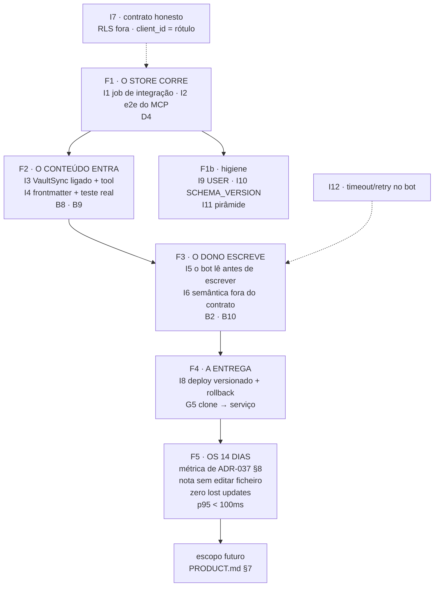

# ikigai — TECH

**Feature id:** `production-readiness`
**Data:** 2026-11-06
**Estado:** plano — as quatro decisões de produto (D1–D4) estão fechadas pelo dono em 2026-11-06
**Âncora:** [`ADR-037`](../../code-docs/adr/ADR-037-data-layer-canonical-turn.md) · [`ADR-013`](../../code-docs/adr/ADR-013-canonical-scope-discipline.md)
**Comportamento:** [`PRODUCT.md`](./PRODUCT.md) (as invariantes `B1`…`B10` e a matriz de prontidão)
**Execução:** [`ROADMAP.md`](./ROADMAP.md) (a árvore de planeamento e os gates)
**Código medido:** `e675b438`

> Este documento diz **como se fecha a distância** entre o estado medido em
> [`PRODUCT.md`](./PRODUCT.md) e o produto a funcionar todos os dias. Não
> repete o que o produto é — isso está no `PRODUCT.md` — e não volta a
> descrever o que já está construído — isso está em §4.

---

## 1. Veredicto

**O esqueleto está pronto e bem vigiado; o que falta é um ensaio e quatro
correcções de contrato.** O código de produto tem 2844 LOC e a rede de guardas
tem 4090 LOC — a disciplina está do lado certo. Mas o store nunca correu
contra um Postgres real, o vault nunca foi ingerido, o grounding estratégico
sai vazio, e o cliente do Telegram só sabe criar. **Nenhuma destas cinco
falta exige arquitectura nova:** são um job de CI, uma tool de ingestão, uma
passada de frontmatter, uma leitura antes da escrita, e um campo fora do
contrato.

---

## 2. Pilha

| Peça | Escolha | Versão / fonte |
|---|---|---|
| Linguagem | Python | 3.11 (`.python-version`) |
| Contratos | Pydantic v2 estrito — `frozen=True`, `extra="forbid"`, `Literal` discriminadores | `src/contracts/pyproject.toml` |
| Store | Postgres 16 + pgvector | `pgvector/pgvector:pg16` (`deploy/compose.yml:19`) |
| Driver | `psycopg` 3 (async) + `psycopg_pool` | `src/data/client.py:176-183` |
| Transporte | **MCP próprio** sobre FastMCP — `stdio` / `streamable-http` / `sse` | `src/transport/mcp_server.py:71,198-220` |
| Cliente | Telegram Bot API (`httpx`) | `src/bot/main.py` |
| Container | 1 Dockerfile, 1 estágio, 3 papéis pelo comando | `deploy/Dockerfile` |
| Orquestração | `docker compose` (3 serviços) | `deploy/compose.yml` |
| CI | GitHub Actions, matriz de 5 pacotes + revisão pré-merge | `.github/workflows/ci.yml` |
| Harness | `pi` — **externo**, declarado em `.pi/mcp.json`, skills em `.pi/skills/` | `specs/harness/router.md` |
| Empacotamento | Poetry (ambiente único em `src/ikigai/`) | `src/ikigai/pyproject.toml` |
| Lint/format | Ruff 0.17.3 **fixado** | `.github/workflows/ci.yml:137` |

**O que a pilha NÃO tem, por decisão:** LangGraph, SDK de modelo, orquestrador,
grafo de agentes, framework de plugin (ADR-037 D7). E, a partir de D2, **provider
de embeddings** (§11).

---

## 3. Justificativa

O que torna este plano necessário não é uma ambição — é uma **medição**:

1. **A suite passa 150 e salta 14** — e os 14 são exactamente os que tocam o
   store real. Passam contra dublês; o caminho SQL real nunca foi percorrido.
2. **O CI não tem Docker nem Postgres** (`ci.yml:9-161` — dois jobs, cinco
   portões de pacote, nenhum serviço). Logo, os 14 saltam **também em cada PR**.
3. **As migrações nunca foram aplicadas a uma base viva.** O runner
   (`apply.py`, 166 LOC) está escrito, com checksum e *advisory lock*, e nunca
   correu.
4. **Consequência:** o contrato "escrevo hoje e releio amanhã" — que é a
   promessa central do produto — **nunca foi demonstrado**.

Isto é exactamente o risco que o próprio `specs/data-layer/TECH.md` §5 registou
como *"a camada de dados serve, e o vault continua vazio"* e que a métrica de
14 dias de ADR-037 §8 foi desenhada para apanhar. A diferença é que hoje
sabemos **onde** está o vazio, e são cinco sítios nomeados — não uma suspeita.

**Porquê agora:** o corte de âmbito (2026-11-05) limpou a árvore e devolveu-a à
forma de um projecto novo. É o melhor momento para ligar o sistema: o
conjunto é pequeno, o contrato está escrito, e a rede de guardas vai dizer
imediatamente se uma correcção o quebrar.

---

## 4. A ponte que já existe

O plano **não** ergue nada de novo. Cada item abaixo já está no repositório e é
o que o plano usa.

| O que já existe | O que dá ao plano | Onde |
|---|---|---|
| **O DOM**: 10 kinds, 10 subclasses tipadas, `KIND_MODELS`, `make_uid` validado | o contrato que o bot valida e que a ingestão escreve | `src/contracts/dom.py`, `dom_kinds.py` |
| **4 pares de migração** up+down + runner com checksum e *advisory lock* | o schema que o CI vai aplicar de verdade | `src/contracts/migrations/` |
| **Pool async** com retry, backoff e transacção | o Postgres que o job de CI vai levantar | `src/data/client.py` |
| **Repositório** com create/update optimista ⇒ `ConflictError`, ledger de idempotência, soft delete, FTS com cursor *keyset* | o 409 e a idempotência de que D3 precisa | `src/data/repository.py:105-183` |
| **Serviços** com envelope validado e travessia *cycle-safe* | o único writer, já com as regras de domínio | `src/services/artifacts.py`, `relations.py` |
| **6 tools MCP** que delegam nos serviços, **zero SQL** | o transporte que o `pi` consome — já fala a língua certa | `src/transport/mcp_server.py:118-195` |
| **Bot** com 8 comandos, validação pré-envio contra `KIND_MODELS`, *fail-closed* | o cliente que D3 vai corrigir | `src/bot/main.py` |
| **Healthcheck que mede o plano de dados** (insere e faz *rollback*) | o PASS do gate G1 | `src/transport/healthcheck.py:65-86` |
| **Contentor + compose** com migrations no arranque e healthchecks encadeados | o stack que o CI vai construir e subir | `deploy/` |
| **`VaultSync`** de 334 LOC que lê o vault e faz *upsert* idempotente — e **nunca escreve no vault** | o motor de ingestão que falta só ser ligado | `src/services/sync.py` |
| **Loader de strategics** com `sha256` por documento | o mecanismo de grounding que precisa de *frontmatter* | `src/ikigai/src/strategics/loader.py` |
| **Rede de guardas** (28 ficheiros, 4090 LOC) *append-only* e falsificada | a rede de segurança de cada passo deste plano | `src/ikigai/tests/` |
| **`pi` instalado** (`~/.pi/agent/bin/pi.ps1`) com as 7 skills copiadas para `.pi/skills/` | o harness pronto a correr uma rotina | `.pi/` |

**O que a ponte não tem:** um caminho **integrado** percorrido uma única vez. É
isso que os gates do `ROADMAP.md` medem.

---

## 5. Quebrado, com evidência

Cada item é um defeito ou uma ausência, com a prova que o localiza.

| # | Quebrado | Evidência | Impacto |
|---|---|---|---|
| **Q1** | **O store nunca correu.** Sem Docker local, sem Postgres no CI. | 14 testes `skipif` (Docker) em `tests/store/{bench,concurrency,relations,rls}.py`; `ci.yml:9-161` sem `services:` | B1, B2, B3 nunca demonstrados |
| **Q2** | **`expected_revision` é sempre `None` no bot.** | `src/bot/main.py:197` (literal `"expected_revision": None`) | editar duplica; o 409 é inalcançável do cliente; o UID deriva de `hash8(body)` (`main.py:164`), logo o corpo novo muda o UID |
| **Q3** | **As embeddings nunca são persistidas.** `set_embedding` não tem caller. | `src/data/repository.py:449` (definição) — zero chamadas; a busca semântica filtra `embedding is not null` (`:424`) ⇒ **sempre vazio**; o índice HNSW (`0002_indexes.sql:19`) está vazio | `semantic: true` e `embed_text` prometem o que não existe |
| **Q4** | **O vault nunca é ingerido.** O `VaultSync` é inalcançável. | `git grep VaultSync` → só docs e testes; ausente de `src/services/wiring.py:28-35` e das 6 tools (`mcp_server.py:118-195`) | **B8 falsa**: o store nasce vazio |
| **Q5** | **O grounding estratégico sai vazio.** | o loader filtra por tag `strategic` (`loader.py:66`); `Select-String '^\s*tags\s*:' strategics/*.md` → **0 ocorrências** nos 9 ficheiros ⇒ índice vazio | **B9 falsa**: o agente corre sem a prosa estratégica |
| **Q6** | **RLS inerte, `client_id` auto-declarado, zero autenticação.** | `force row level security` → 0 ocorrências; `set_config` → só `store.py:46` (docstring) e `test_store_rls.py:106`; `client_id` vem de um parâmetro da tool (`mcp_server.py:144`) | o store promete isolamento que não tem |
| **Q7** | **Não existe e2e.** | `-m "not e2e"` não exclui nada: **nenhum** ficheiro versionado usa o marcador; o único candidato (`test_vault_sync_e2e.py`) está gitignored (`.gitignore:462`) | nada liga Telegram → `/mcp` → Postgres → releitura |
| **Q8** | **A entrega não é reproduzível a partir do branch.** | `scripts/` está gitignored (`.gitignore:401`) ⇒ `deploy-vps.sh` **não existe num clone**; sem `image:` fixado no compose (`:41-43`); sem backup do volume `db-data` (`:104`) | o deploy depende de uma máquina, não do repositório |
| **Q9** | **O CI nunca constrói a imagem.** | `ci.yml:9-161`: dois jobs; nenhum `docker build`, nenhum `compose up` | um Dockerfile partido passa o CI |
| **Q10** | **O contentor corre como root** e instala `curl` que não usa. | `deploy/Dockerfile` sem `USER`; `curl` instalado (`:26-28`) e o healthcheck é um módulo Python (`:74-75`) | superfície e imagem maiores do que o necessário |
| **Q11** | **A pirâmide está invertida num ponto.** | `src/data/repository.py:445` importa `src.services.embeddings` (data → services) | o guard de layering (`test_drift_invariants.py:129-146`) só proíbe quem está *fora* de data/services |
| **Q12** | **`SCHEMA_VERSION = 1` é decorativo.** | `src/contracts/store.py:36` — exportado, lido por ninguém; há 4 migrações e o ledger real é `ikig.schema_migrations` | uma constante que mente |
| **Q13** | **A busca semântica ignora `status`, `parent_uid` e o cursor**, e não usa o padrão `_page`. | `repository.py:421-442` vs `459-468` | resultados semânticos não são filtráveis nem pagináveis |
| **Q14** | **O cliente MCP do bot não tem timeout nem retry.** | `src/bot/main.py:258-261` | um `call` pendurado trava o *polling* sequencial (`:351-368`) |

---

## 6. Inventário, com razão

O que este plano constrói. Cada item diz **porque** existe — um item sem razão
é um item que não devia entrar.

| # | Item | Razão | Serve | Custo |
|---|---|---|---|---|
| **I1** | **Job de integração no CI**: constrói a imagem, sobe o compose (db + api), aplica as migrações, corre o healthcheck e os 14 testes do store | Q1, Q9 — o store deixa de ser código não exercitado, e passa a ter um lugar onde se prova | B1, B2, B3 | 1 dia |
| **I2** | **Teste e2e do MCP**: escrever um artefacto pelo MCP HTTP e relê-lo, com o Postgres real | Q7 — o ensaio que nunca existiu, ao nível que o CI pode correr | B1 | 0,5 dia |
| **I3** | **`VaultSync` ligado ao `Services` + uma tool MCP de ingestão** | Q4 — sem isto o store nasce vazio e o vault é prosa morta | B8 | 0,5 dia |
| **I4** | **Frontmatter `tags:` nos 9 `strategics/*.md` + um teste que aponte para o corpus real** | Q5 — o grounding tem de chegar ao agente, e o teste actual usa fixtures inventadas | B9 | 0,5 dia |
| **I5** | **O bot lê antes de escrever**: procura o artefacto do mesmo `kind` cujo 3.º segmento do UID é `hash8(message_id)`, e envia a revisão actual | Q2 — a âncora da identidade é o `message_id` (o `Artifact` não tem campo livre para o guardar); sem isto o 409 nunca existe do lado do cliente | B2 | 1 dia |
| **I6** | **`embed_text` e `semantic: true` fora do contrato v1** | Q3 + D2 — o MCP passa a ter 5 tools honestas | honestidade do contrato | 0,5 dia |
| **I7** | **Contrato sem promessa de isolamento**: `client_id` passa a ser rótulo de auditoria; a RLS fica documentada como inerte; uma guarda afirma que o store é single-player | Q6 + D1 — a alternativa não é mentir: é dizer o que é | coerência | 0,5 dia |
| **I8** | **`scripts/deploy-vps.sh` versionado**, com `image:` fixado, dump do volume antes do `up` e rollback | Q8 — o deploy passa a ser do branch, não de uma máquina | G5 | 1 dia |
| **I9** | **`USER` no Dockerfile**, `curl` removido | Q10 — superfície mínima | higiene | 1 hora |
| **I10** | **`SCHEMA_VERSION` lido pelo runner** (ou removido) | Q12 — uma constante que mente é pior do que nenhuma | honestidade | 1 hora |
| **I11** | **A inversão data→services desfeita** (`EmbeddingProvider` passa a `Protocol` no `src/data`, ou a dependência sobe para `wiring.py`) | Q11 — a pirâmide é uma regra, não uma sugestão | regra 1 | 0,5 dia |
| **I12** | **Timeout e retry no cliente MCP do bot** | Q14 — uma chamada pendurada trava o polling | robustez | 2 horas |

**Fora do inventário, deliberadamente:** provider de embeddings (§11 D2), RLS
activado, edição inline no Telegram, `vault_write`, TUI, camada algorítmica.
Todos estão registados como escopo futuro em [`PRODUCT.md` §7](./PRODUCT.md).

**A guarda que a D2 toca — e porque não a enfraquece.** O conjunto canónico de
tools vive em `src/ikigai/tests/test_drift_invariants.py:34-43`
(`CANONICAL_TOOLS`), e `test_transport_exposes_exactly_the_canonical_tools`
exige que o transporte exponha **exactamente** esse conjunto. I6 tira
`embed_text`, logo o conjunto passa de **6 para 5**.

A guarda **não é enfraquecida**: o que ela assegura — *o conjunto de tools é
fixo e declarado* — continua verdadeiro, e passa a ser verdadeiro sobre o
conjunto certo. A mudança é do **contrato**, não da guarda, e a razão fica
escrita na **ADR-039** antes de o código mudar. É a diferença entre mudar uma
expectativa porque o defeito se mexeu com ela (que é proibido) e mudar uma
expectativa porque o contrato mudou **com a razão registada** (que é o
exercício).

O mesmo se aplica ao `client_id`: sair do `WriteRequest` como fronteira de
segurança (D1) toca a forma do payload — e a razão é a **ADR-038**.

---

## 7. Dia zero

**O estado em 2026-11-06, `e675b438`:**

- 314 ficheiros publicados · 122 markdown · 2844 LOC de produto · 4090 LOC de guardas
- suite: **150 passed, 14 skipped** — os 14 são o store real
- CI: 2 jobs, 5 portões de pacote, **0 construções de imagem**
- `pi` instalado, 7 skills em `.pi/skills/`, `.pi/mcp.json` versionado
- **Docker ausente** nesta máquina; **VPS inalcançável** (167.233.192.242: 22/tcp, ICMP e HTTP em timeout)
- 5 invariantes provadas · 3 parciais · 2 não provadas

**O primeiro marco (F1) é uma frase:** *o Postgres real aceita o schema, o
repositório escreve e relê, e os 14 testes que saltam hoje passam.*

**Porquê F1 e nada mais:** nenhuma das outras correcções (I3, I4, I5) se pode
provar sem um store a correr. Fazer I5 (o bot revisa) sem Postgres real é
fazer o mesmo que hoje — testar contra dublês.

---

## 8. Evolução

| Fase | Leva | PASS | Invariantes |
|---|---|---|:-:|
| **F1** | I1, I2 (+ I9, I10, I11 de higiene) | os 14 testes do store **passam** no CI; o e2e do MCP escreve e relê | B1, B2, B3 |
| **F2** | I3, I4 | o store tem linhas do `vault/`; o índice de `strategics/` **não está vazio** | B8, B9 |
| **F3** | I5, I6, I12 | editar uma nota no Telegram **revisa** (revolução sobe, não duplica); o MCP tem 5 tools | B2, B10 |
| **F4** | I8, I7 | `git clone` → `docker compose up` → healthcheck verde, **sem mão** | — |
| **F5** | a métrica | as três métricas de ADR-037 §8 medidas durante 14 dias | B1, B2 |

---

## 9. Passos, com PASS falsificável

Cada passo tem um PASS que **reprova quando a violação é reintroduzida**. Um
PASS que não pode falhar não é um PASS.

| Passo | O que se faz | PASS falsificável | Falsificação |
|---|---|---|---|
| **S1** | job de integração no CI (build → compose db+api → migrations → healthcheck → 14 testes) | no CI, os 14 testes do store **passam** (hoje: `skipped`) | remover `services:` do job ⇒ os testes voltam a saltar ⇒ **o job falha** |
| **S2** | e2e do MCP: `upsert_artifact` → `get_artifact` → a revisão é a esperada | o artefacto relido tem o `uid`, o `kind` e a `revision` correctos | pôr `expected_revision` stale ⇒ o e2e tem de ver **409**, não um artefacto |
| **S3** | `VaultSync` no `Services` + tool MCP de ingestão | `search_artifacts` devolve uma linha com o `body_hash` do ficheiro do vault | desligar o `VaultSync` do wiring ⇒ a tool devolve vazio ⇒ **o teste falha** |
| **S4** | `tags:` nos 9 `strategics/*.md` + teste contra o corpus real | o índice do loader **tem os 9 documentos** e o `sha256` bate | remover o `tags:` de um ficheiro ⇒ o índice perde-o ⇒ **o teste falha** |
| **S5** | o bot lê antes de escrever | enviar a mesma nota duas vezes ⇒ **a segunda revisa** (revisão 2, um artefacto) e nunca duplica | pôr `expected_revision: None` de volta ⇒ duplica ⇒ **o teste falha** |
| **S6** | `embed_text` e `semantic` fora do contrato | o MCP expõe **5** tools; `search_artifacts` com `semantic` é **rejeitado** pelo contrato | reintroduzir a 6.ª tool ⇒ o guard conta ⇒ **falha** |
| **S7** | contrato honesto: `client_id` é rótulo; guarda que afirma o single-player | a guarda **prova** que nenhuma política de isolamento é prometida | introduzir um segundo `client_id` no produto ⇒ a guarda falha e aponta para a alternativa de D1 |
| **S8** | `deploy-vps.sh` versionado, `image:` fixado, dump antes do `up` | `git clone` + `bash scripts/deploy-vps.sh` num clone **limpo** chega a healthcheck verde | trocar o script por uma versão que não faz dump ⇒ o teste de rollback falha |
| **S9** | `USER` no Dockerfile; `curl` removido | o healthcheck **passa** com o utilizador não-root | correr o healthcheck como root e o guard falha |

**A regra que rege todos**: cada PASS é executado no CI, e a violação é
reintroduzida **pelo menos uma vez** para se ver o PASS reprovar. Um passo
entregue sem falsificação não está entregue — é uma intenção.

---

## 10. Fora de escopo

| Fora | Porquê |
|---|---|
| **Provider de embeddings** | D2 — sai do contrato v1; fica em `PRODUCT.md` §7 como T4, depois da validação cloud native |
| **RLS activo, `force row level security`, `set_config`** | D1 — o store é single-player; a alternativa fica registada com o seu gatilho |
| **Autenticação no MCP (token, OAuth)** | D1 — o transporte é loopback; só entra com o trigger de T3 |
| **Edição inline no Telegram** | D3 alt — só quando D3 gerar duplicados na prática |
| **`vault_write` (escrever no vault)** | ADR-012; T5 — exige B8 fiável primeiro |
| **PAV, *hysteresis*, scoring** | ADR-037 D1 — T9, e a métrica de 14 dias antes |
| **TUI, web, timeline** | T7, T8 — o DOM tem de estar estável para uma segunda leitura |
| **Apagar conteúdo** | ADR-037 §"publicação independente" — nada é apagado, nunca |
| **Multi-utilizador, multi-tenant, HA** | o produto é de uma pessoa só |

---

## 11. Decisões, com default

Cada decisão tem um **default** (o que se faz se ninguém decidir), a
**alternativa** (o degrau seguinte) e o **gatilho** que a faz entrar. As
alternativas não se perdem: estão em [`PRODUCT.md` §7](./PRODUCT.md).

| # | Default (vigora agora) | Alternativa | Gatilho |
|---|---|---|---|
| **D1** | **RLS fora do caminho crítico.** `client_id` é rótulo de auditoria; a política é documentada como inerte; uma guarda afirma o single-player | activar o RLS a sério (`force` + `set_config` + role de aplicação) | dois `client_id` distintos a falar com o mesmo store (T3) |
| **D2** | **Semântica fora do contrato v1.** 5 tools; `semantic` sai; o hashing-trick fica interno | provider real de embeddings | caminho cloud native validado **e** ≥ 5 000 artefactos com busca por sinónimos a falhar (T4) |
| **D3** | **O bot revisa.** Lê a revisão actual antes de escrever; a âncora é o 3.º segmento do UID (`hash8(message_id)`) | Telegram append-only, ou edição inline mapeada para `upsert` | o dono editar de facto notas no Telegram (duplicados a aparecerem) |
| **D4** | **O stack corre primeiro no CI.** O GitHub Actions tem Docker: build → compose → migrations → healthcheck → 14 testes | Docker Desktop local, ou o VPS como primeiro runner | o ciclo de feedback do CI ficar lento para iterar no store |

**Decisões técnicas que este plano fecha sem o dono** (todas reversíveis e
baratas): I9 (utilizador não-root), I10 (`SCHEMA_VERSION`), I11 (a pirâmide
invertida), I12 (timeout/retry), I8 (o script de deploy passa a ser do branch).

---

## 12. Camadas de falha

Cada camada tem o seu modo de falha e o que acontece quando falha. O que
**não** há é um modo de falha que caia no vazio.

| Camada | Falha | Como se manifesta | O que acontece |
|---|---|---|---|
| **Store** | Postgres inacessível | `StoreNotConfiguredError` / timeout do pool | erro tipado; **sem fallback para ficheiro** — o store é canónico |
| **Store** | migração não aplica | o container api não sobe (`compose.yml:52`) | melhor um contentor morto do que um serviço "saudável" que erra em cada escrita |
| **Store** | escrita com revisão obsoleta | **409** | o cliente lê a revisão actual e decide; **nunca forçar** |
| **Store** | RLS inerte (D1) | nada — e é esse o ponto | documentado e vigiado pela guarda de S7 |
| **Serviços** | payload viola o contrato | `VALIDATION` | o erro nomeia o campo; o bot pergunta a 2.ª linha em vez de escrever |
| **Serviços** | ingestão idempotente | 2 execuções ⇒ mesmo count | o ledger de idempotência segura |
| **Transporte** | api caída | o bot não obtém resposta | timeout + retry (I12); o *polling* não trava |
| **Transporte** | MCP sem autenticação (D1) | — | loopback-only + túnel SSH; o risco é do owner, por desenho |
| **Cliente** | `IKIGAI_BOT_ALLOWED_CHAT_IDS` vazio | `SystemExit` | **falha fechada**: sem allowlist, não há bot |
| **Cliente** | chat não listado | sem resposta, sem rasto | o bot não fala com estranhos |
| **Harness** | a skill pede um comando que não existe | o agente reporta a lacuna | **não inventa o comando** |
| **CI** | um PASS não pode falhar | a falsificação é obrigatória | um passo sem falsificação não está entregue (§9) |

---

## 13. Referências

**Dentro do repositório**

| Documento | O que traz |
|---|---|
| [`PRODUCT.md`](./PRODUCT.md) | o produto, as invariantes `B1`–`B10`, a matriz de prontidão, o escopo futuro |
| [`ROADMAP.md`](./ROADMAP.md) | a árvore BRD→PRD→SPEC→ADR→TECH→Tasks, o grafo, os gates `G1`–`G5` |
| [`specs/data-layer/TECH.md`](../data-layer/TECH.md) | o plano da camada de dados (2026-11-01) — a origem de I1–I4 |
| [`specs/harness/router.md`](../harness/router.md) | o contrato do harness: papéis, cadências, e os erros que se encontram |
| [`ADR-037`](../../code-docs/adr/ADR-037-data-layer-canonical-turn.md) | a virada canónica: as 4 regras, o corte, a métrica de 14 dias |
| [`ADR-013`](../../code-docs/adr/ADR-013-canonical-scope-discipline.md) | a disciplina de âmbito: o que a camada de agente não pode fazer |
| [`ADR-011`](../../code-docs/adr/ADR-011-ikigai-mcp-http-sse-transport.md) | o transporte MCP sobre HTTP/SSE |
| [`README.md`](../../README.md) | a porta: o que o repositório é |

**Externas**

- SDD — o fluxo Specify → Plan → Tasks → Implement, com revisão humana em cada
  fronteira: <https://blog.allegro.tech/2026/06/spec-driven-development-best-practices.html>
- A convenção `PRODUCT.md` / `TECH.md`: `PRODUCT.md` guarda o **comportamento**
  (com invariantes numeradas e *sem* secção de validação); `TECH.md` guarda o
  **plano de implementação** e referencia o `PRODUCT.md` em vez de o repetir —
  <https://github.com/warpdotdev/common-skills/blob/main/.agents/skills/write-tech-spec/SKILL.md>
- A hierarquia `requirements → design → tasks` e os ficheiros de *steering*
  (`product.md`, `tech.md`, `structure.md`) —
  <https://github.com/Pimzino/spec-workflow-mcp/blob/main/docs/WORKFLOW.md>

**Medições**

Todas as afirmações deste documento são verificáveis em `e675b438`. A
medição que o origina está no [`PRODUCT.md` §3](./PRODUCT.md) e a
correspondência *gap → passo* está no [`ROADMAP.md`](./ROADMAP.md).

---

*TECH.md — 2026-11-06 — decisões D1–D4 fechadas pelo dono em 2026-11-06.
Actualizar no mesmo PR em que um item de §6 mude, ou em que um gatilho de §11
dispare.*
